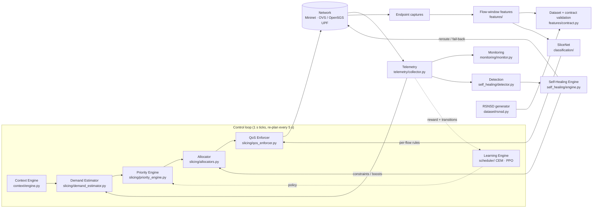
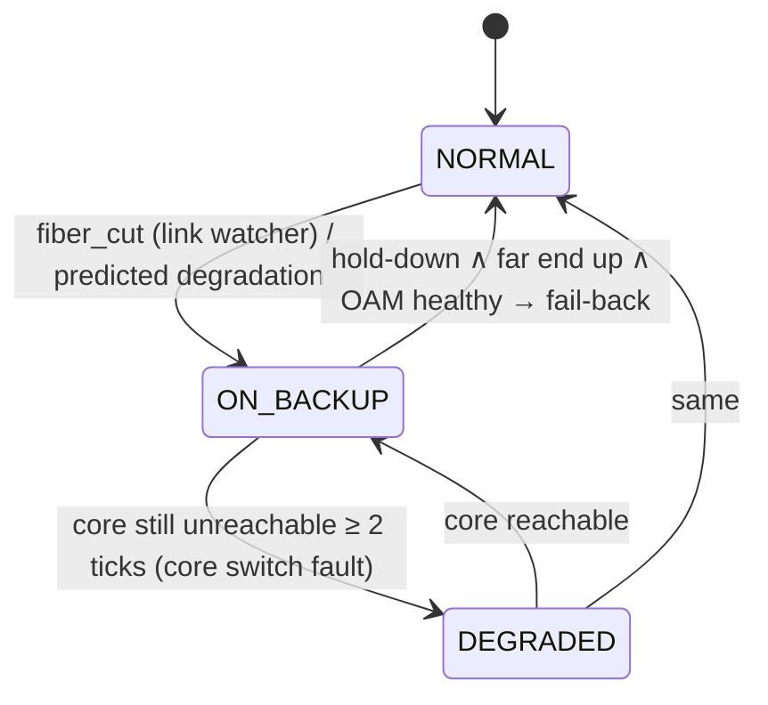

# CARS-SF System Architecture

**Context-Aware Rural Service Slicing Framework with autonomous self-healing for private 5G networks.**

This document describes the system as implemented. The original vision document
([architecture.md](architecture.md)) is kept for reference, and §13 maps each of its
modules and principles onto the code. Measured results are in
[docs/thesis/results.md](docs/thesis/results.md).

---

## 1. End-to-end pipeline



`core/orchestrator.py` runs one experiment. `core/controller.py` is the closed loop.
Every stage can be replaced by any object satisfying its protocol in
`core/interfaces.py`, and schedulers are *compositions* declared in
`registries/schedulers.yaml`.

## 2. Module map

| Stage | Path | What it does |
|---|---|---|
| Registries | `registries/*.yaml` | Applications (traffic models, SLAs, DSCP), scenarios (priorities, demand, failure specs), slices (classes, floors, SLAs, 3GPP mapping), timelines, schedulers, feature schema |
| Topology | `topology/rural_topology.py` | N UEs per service (plus an optional mixed-service UE), 100 Mbps rural uplink (the bottleneck), edge and core clouds, fiber backhaul plus a standby 50 Mbps backup |
| Traffic | `traffic/` | Seeded traffic models (VBR video, VoIP, IoT periodic, Pareto on/off, paced bulk TCP, web request/response, DASH), a generator/sink pair, demand scaling and live context switching |
| Telemetry | `telemetry/collector.py` | Per-tick deltas of interface counters, HTB class stats in both directions, background RTT probes, a 50 ms link watcher, OVS stats (OVS only) and endpoint packet captures |
| Context Engine | `context/engine.py` | Clock, season calendar, alerts and admin override → context id; compressed-day timelines |
| Demand | `slicing/demand_estimator.py` | Measured offered load, elastic probe-up and a Holt forecast (or the design-time oracle) |
| Priority Engine | `slicing/priority_engine.py` | Context priority matrix × policy multipliers (rule, CEM or PPO) |
| Allocation | `slicing/allocators.py` | Demand-aware with floors and surplus redistribution (proposed); no-surplus ablation; proportional; static; 3GPP; none |
| QoS | `slicing/qos_enforcer.py` | HTB + `fq_codel` on both directions of the uplink; work-conserving or strict; host, app or per-flow classification; OVS `linux-htb` backend |
| Controller | `core/controller.py` | Closed loop with estimator warm-up, change threshold, healing constraints and backup ceilings |
| Monitoring | `monitoring/monitor.py` | Per-slice SLA checks every tick (latency, loss, satisfaction); flow-level SLA checks |
| Self-healing | `self_healing/` | Reactive and predictive detection, failure injection, a state machine with loop-free failover, fault localisation, OAM-checked fail-back |
| Learning | `scheduler/` | Contextual-bandit CEM; sequential Gymnasium environment calibrated from runs; PPO (stable-baselines3) |
| Features | `features/` | Packet matching (one-way delay, loss), 5 s flow windows, traffic-shape features and packet sequences, schema with provenance |
| Data contract | `features/contract.py`, `dataset/rsnsd.py`, `core/provenance.py` | One versioned schema (`rsnsd-contract-2.0`) for synthetic, Mininet and 5G records; provenance stamping; rejecting validation; manifests with seed, sha256 and code fingerprint |
| Reward / transitions | `scheduler/reward.py`, `scheduler/transitions.py` | One reward for simulator and live loop; (s, a, r, s′) log of every live decision |
| Pipeline | `run_pipeline.py` | Modes unit / synthetic / mininet / rl / full; fail-fast environment check; per-stage manifest |
| SliceNet | `classification/` | Random forest and PyTorch 1D-CNN; held-out-group evaluation; synthetic-to-measured transfer; in-loop classifier |
| Validation | `validation/validator.py` | Schema, class balance, physical consistency, measurement coverage, load–delay relation, feature quality |
| Analysis | `analysis/metrics.py`, `experiments/aggregate.py` | Per-slice KPIs, Jain fairness, weighted utility, outage; 95 % CIs; paired Wilcoxon tests |
| Experiments | `experiments/run_matrix.py`, `configs/experiments/*.yaml` | Declarative, parallel, resumable matrices with git hash and seed per run |
| 5G core | `deployment/5g/` | Open5GS 5GC + UERANSIM; one slice per service (S-NSSAI, DNN, pool); CARS-SF enforcement on the UPF |

## 3. Network

```
UEs (2 per service; 10.0.1.x)                         edge cloud: srv_edge, mec_hlt, mec_ctv
   │ access links (unshaped)                          ┌──────────────────────────┐
 s_rural ══ rural uplink 100 Mbps (bottleneck) ══ s_edge ── fiber 20 ms ── s_core ── srv_core
           s_rural-up / s_edge-down                     └┄┄ backup 50 Mbps, 40 ms ┄┄┘ (standby)
```

* **One contention point.** Access links are left unshaped, so slicing decisions,
  not access-link artefacts, decide per-service performance.
* **Delay placement.** The QoS enforcer owns both qdiscs of the rural uplink. A
  sender's capture also only sees packets after its egress qdisc. So each path's
  one-way propagation delay (8 ms UE↔edge, 28 ms UE↔core) is emulated on the
  switch egress port facing the *destination*, and measured delay floors equal
  the configured propagation exactly.
* **Switch ports** are named `<switch>-<port>`. Mininet's `LinuxBridge` only
  attaches such interfaces, and names fit the 15-character kernel limit.
* **Switches.** Real runs use `OVSBridge` (standalone, no controller). Sudo-free
  runs use Linux bridges inside a user and network namespace
  (`tests/integration/harness.py`). Everything else is identical: veth links, tc,
  traffic, captures, faults and recovery.

## 4. Control loop (per tick)

1. **Context:** `ContextInferenceEngine.step(tick)`. A timeline change re-spawns traffic with the new demand.
2. **Fault injection:** the scenario's failure spec (fiber cut, backhaul degradation, core switch failure).
3. **Telemetry:** per-tick deltas, class stats, RTT probes, link events.
4. **Monitoring:** per-slice SLA records against `slices.yaml`.
5. **Detection:** reactive (link events, congestion, saturation, latency spikes, core unreachable) plus predictive (RTT trends).
6. **Self-healing:** network actions, plus constraints and boosts for the controller.
7. **Reward:** the snapshot measures the interval that just ended, so its shared reward (`scheduler/reward.py`) is computed with the allocation, demand and context in force *during* that interval. It is written to `feedback.csv` and credited to the open RL transition **before** the controller decides again.
8. **Controller:**
   * The demand estimator observes every tick.
   * A decision is triggered by a context change, a healing-state or boost change, or every control interval (5 ticks). It builds the RL observation, computes priorities (policy multipliers) → allocation → constraints, and opens a new transition.
   * If any slice changes by ≥ 1 Mbps, the allocation is applied and **read back** from the kernel (`tc class show`).
   * On a failed command or a rate mismatch (`verified: False`), the last good allocation stays current, the failure is counted, and the transition is marked not learnable.
9. **SliceNet (optional):** classifies unclassified flows from a mixed UE and installs per-flow rules (with confidence-gated fallback, §9).

At the end of a run, the open transition is closed and `rl_transitions.jsonl` is written. Teardown (traffic, captures, injected faults, the network) runs in a `finally` block, which SIGTERM also reaches because the entry points turn it into `SystemExit`.

## 5. Measurement

Every UE and server interface is captured at a 128 B snap length. Each packet is
matched between its sender's capture (tx) and its receiver's capture (rx) on a
fingerprint (addresses, ports, IP ID, TCP seq/ack, payload prefix; UDP payloads
start with a sequence number). Because all endpoints share one kernel clock,
`rx − tx` is the true one-way delay:

| Field | Definition |
|---|---|
| `end_to_end_latency_ms` | Mean one-way delay of delivered data-direction packets in the window |
| `p95_latency_ms` | 95th percentile of the same |
| `jitter_ms` | Mean absolute difference of consecutive one-way delays (RFC 3550 style) |
| `packet_loss_rate` | Packets sent but never received (excluding the last 1 s in flight) |
| `queueing_delay_ms` | One-way delay above the flow's propagation floor |
| `throughput_mbps` / `goodput_mbps` | Delivered bytes per window (goodput excludes retransmissions) |

The *data direction* is whichever direction carried more bytes. A record is one
application flow of one UE in one 5 s window. Scenario-injected radio and context
columns are retained for RSNSD schema compatibility but are tagged
`CONTEXT_INJECTED` and excluded from ML, as are ports, DSCP and timestamps.

## 6. Slicing

* **Classes:** four service slices (healthcare 1:10 … general 1:40), each with a floor
  and an SLA, or three 3GPP slices (URLLC/eMBB/mMTC) for the baseline.
* **Enforcement:** HTB `rate` = allocation; `ceil` = link capacity (work-conserving) or
  = allocation (strict); `fq_codel` leaves; both directions.
* **Classification modes:**
  * `host` (default): UE address → its service, which is realistic for single-institution UEs;
  * `app`: registry server/port, an oracle, also used for 3GPP;
  * `slicenet`: per-flow rules from the in-loop classifier.
* **Schedulers** (`registries/schedulers.yaml`): proposed, context_unaware (proposed with
  the normal-context matrix throughout), rl_cem, rl_ppo, rl_online, no_surplus,
  proportional, static_equal, tgpp, no_slicing.

## 7. Self-healing



* **Loop-free by construction.** The primary is quarantined *before* the backup is
  enabled, and the backup is disabled *before* the primary returns. Only
  `s_edge`-side ports are driven.
* **OAM check.** The quarantined primary's quality is checked with a stand-in for
  Y.1731/BFD delay and loss measurement; in emulation it reads the link's
  configured impairment.
* **Own actions ignored.** Link transitions caused by the healer's own actions are not
  treated as new faults.
* **Constraints instead of overrides.** While on backup, core-bound slices are capped
  at the backup capacity (95 %) with HTB ceilings, so the smaller link's queue stays
  empty. When the core is down, core-bound slices keep their floor and edge slices
  use the freed capacity.
* **Post-recovery verification.** After `activate_backup` or `fail_back`, the engine
  expects every core-bound service to answer its probe for 2 consecutive ticks. It then
  logs `recovery_verified` with the time to restore. If that has not happened within
  5 ticks, it logs `recovery_unverified_escalate` and appends an escalation. Entering
  DEGRADED (core switch fault) is always escalated, because it needs physical repair.
* **Healthy telemetry only.** Missing interface counters or stale probes are reported in
  `telemetry_health`. They never read as "zero traffic": the throughput-collapse
  detector and the demand estimator skip such ticks.
* **Metrics:**
  * control-plane MTTD and MTTR from timestamps;
  * service outage = longest delivery gap of core-bound flows, from matched packets;
  * packets lost during failover.

## 8. Learning engine

The full specification (state, action, reward, timing, seeds) is in [RL_DESIGN.md](RL_DESIGN.md).

* **Sequential environment** (`scheduler/env_seq.py`, Gymnasium) has real dynamics:
  * backlog carried between steps, with overflow loss;
  * autocorrelated demand and Markov context switches;
  * random backhaul outages;
  * work-conserving service matching HTB;
  * the live allocator and constraint logic.

  It is calibrated from run feedback (`scheduler/calibrate.py`).
* **CEM and PPO** are both trained on it with the shared reward. They are selected on
  validation seeds and compared on disjoint test seeds, paired against the rule-based
  policy.
* **Live loop.** Policies change only the priority matrix, so floors and constraints
  always apply. Every live decision is logged as an (s, a, r, s′) transition in the
  simulator's observation and action spaces. `rl_online` (online CEM) learns from the
  transitions whose enforcement was verified, with a checkpoint that carries across runs.

## 9. SliceNet

* **Features:** traffic shape only (sizes, timing, direction, bursts, TCP control) as seen
  at one vantage point. QoS outcomes are excluded because they depend on the slice
  decision itself.
* **Models:**
  * random forest on 31 shape features;
  * 1D-CNN (PyTorch) on the first 32 packets (signed size, log inter-arrival time,
    TCP control) fused with the shape vector.
* **Evaluation:** whole groups are held out, never random rows: run × UE for measured
  data, RSNSD scenario for synthetic data. The CNN's early stopping uses validation
  groups carved from the training groups. Reports give per-class precision, recall and
  F1, a confusion matrix, and the abstention rate and accepted accuracy at the
  confidence threshold. The transfer study trains on RSNSD synthetic data plus a
  growing share of measured groups.
* **Fallback policy.** A window whose top-class probability is below 0.5, or whose
  features are not finite, is abstained on. The online classifier then leaves the
  flow in the UE's default class and retries with more packets. After 3 abstentions it
  pins the flow to `general` (best effort) and records a fallback decision. An untrained
  model raises `ModelNotTrained`: ground truth is never substituted for a prediction.
* **In the loop:** `classification/online.py` classifies a mixed-service UE's flows from
  its live capture and installs per-flow HTB rules. It uses whichever model scored
  better on held-out data.

## 10. Real 5G core (`deployment/5g/`)

Open5GS 2.7.2 (all 5GC network functions in one container, SBI on loopback), MongoDB
subscribers, a UERANSIM gNB and one UE per service:

| Service | S-NSSAI | DNN | Pool |
|---|---|---|---|
| Healthcare | SST 2 / SD 000001 | health | 10.60.0.0/24 |
| Education | SST 1 / SD 000002 | edu | 10.61.0.0/24 |
| Agriculture | SST 3 / SD 000003 | agri | 10.62.0.0/24 |
| General | SST 1 / SD 000004 | internet | 10.63.0.0/24 |

`run_5g.py` drives the *same* `SliceController` with a UPF QoS backend: HTB +
`fq_codel` on N6 egress (uplink) and `ogstun` (downlink), classified by slice pool.
Traffic sidecars share each UE's network namespace. Captures on `uesimtun0` (raw IP)
and on the data network feed the same matching and KPI code.

## 11. Data contract and provenance

* **Schema.** `features/contract.py` (`rsnsd-contract-2.0`) defines one schema for all
  three sources: `synthetic_rsnsd`, `mininet_measured` and `5g_core_measured`.
* **Provenance.** Every record carries `provenance_source`, `schema_version`, `seed` and
  `config_id`.
* **Field categories.** Each field is classed as measured, derived, configured,
  synthetic, label, identifier or provenance (`data_dictionary(source)`).
* **Rejection, not coercion.** `validate()` rejects missing columns, non-numeric
  numerics, labels outside the taxonomy, negative or missing values (missing delay only
  for measured windows without a delivered packet), loss outside [0, 100],
  goodput > throughput, inconsistent packet counts, and a wrong source or schema version.
* **Path A** (`python -m dataset.rsnsd --seed 42`) is byte-reproducible across processes
  (seeded generators; the RSNSD module-level RNG is seeded and restored; a stable hash
  for ports). It writes a manifest with seed, configuration, class counts, sha256, code
  fingerprint, contract result and RSNSD's statistical validation score.
* **Path B.** Each Mininet run stamps and validates its dataset and records the report
  in `summary.json`. `experiments/collect_dataset.py` rejects non-conforming runs before
  merging and writes a manifest. The 5G runner stamps `5g_core_measured`.
* **Separation.** Synthetic and measured records are never mixed silently. The transfer
  study tests on held-out measured groups only.

## 12. Experiments and reproducibility

* `configs/experiments/thesis.yaml` defines eight studies: main, ablation, capacity
  and load sensitivity, scalability, resilience, timeline, in-loop SliceNet and online RL.
* `experiments/run_matrix.py` expands them and runs them in parallel. It records
  parameters, the git hash, and the **code and model fingerprints** for each run
  (`core/provenance.py`).
* A finished run with different fingerprints is reported as *stale*. With
  `--rerun-stale` it is archived and re-run. The aggregator flags stale runs and writes
  `results/tables/provenance.json`.
* `run_pipeline.py --mode full` runs everything with a manifest.
* `experiments/aggregate.py` produces tables with 95 % CIs and paired Wilcoxon tests;
  `experiments/plots/plot_thesis.py` draws the figures from those tables.
* `make regression` = unit tests + emulated-network integration tests. CI
  (`.github/workflows/ci.yml`) also runs a real OVS experiment.

## 13. Mapping to the original architecture

| architecture.md | Implemented as | Notes |
|---|---|---|
| §4.1 Context Engine (time, season, alerts, policy) | `ContextInferenceEngine` + timelines | `slicing/context_engine.py` holds the per-context priority matrices |
| §4.2 Demand Generator → measured / forecast | `MeasuredDemandEstimator` (Holt), traffic models | ML forecasting (LSTM) not implemented; Holt forecasting is |
| §4.3 Priority Engine → AI priorities | `PriorityEngine` + CEM/PPO policies | |
| §4.4 Allocation: priority + demand + surplus → RL | `DemandAwareAllocator`; RL adjusts priorities | RL never bypasses floors or constraints |
| §4.5 QoS Enforcer: simulated → OVS / tc / SDN | tc HTB + `fq_codel`; OVS `linux-htb` backend; UPF backend | The OVS backend needs a sudo run to verify |
| §4.6 Monitoring (throughput, loss, latency, queues, utilisation) | Telemetry + `SliceMonitor` | |
| §4.7 Self-healing (congestion, link, switch; reroute, backup, load balancing) | `SelfHealingEngine` | Load balancing across primary and backup **not implemented**: the emulated L2 domain has no STP or multipath, so the backup is strictly standby |
| §4.8 Learning engine | `scheduler/` | Learns priorities; scheduling is learned only through priorities |
| Principle 4: modular evolution | `core/interfaces.py`, `schedulers.yaml` | Same controller drives Mininet tc, OVS and an Open5GS UPF |
| Contribution 6: AI-driven adaptive slicing | SliceNet in-loop + RL policies | See results for the measured effect |

## 14. Known limitations

* **Emulation, not radio.** Radio fields are scenario-injected and excluded from ML.
  The 5G deployment uses UERANSIM, whose user-space GTP path saturates at modest
  per-UE rates (experiments there use a 10 Mbps UPF bottleneck).
* **Switch type.** Sudo-free runs use Linux bridges; the OVS-specific code (flow stats,
  `fdb/flush`, the `linux-htb` backend) is exercised only by a sudo run or CI.
* **OAM.** The fail-back quality check reads the emulated link's impairment, standing in
  for real Y.1731/BFD measurement.
* **Elastic demand.** TCP demand is estimated by probing up when a slice is saturated;
  true elastic demand is unobservable.
* **Live RL is sample-poor.** One live transition takes one control interval (≈ 5 s), so
  online CEM sees tens of samples per context, not the hundreds of thousands PPO sees in
  simulation. The live loop demonstrates real coupling and bounded online adaptation, not
  convergence on the real network. The simulator and the live reward differ where noted
  in RL_DESIGN.md (single pipe vs full duplex; modelled vs probed delay).
* **SliceNet confidence** is the forest's vote share or the CNN's softmax. Neither is
  calibrated, so the 0.5 threshold is a conservative gate rather than a probability
  guarantee.
