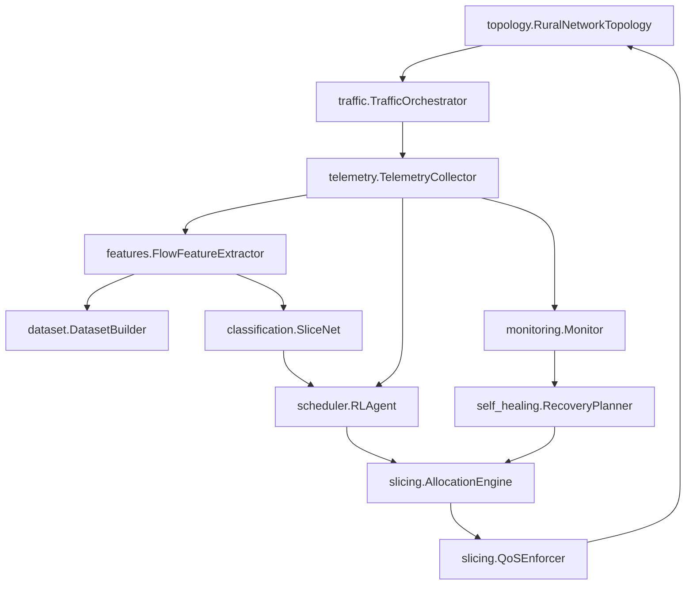

# CARS-SF System Architecture

**AI-Driven Context-Aware Rural Service Slicing and Autonomous Self-Healing Framework for Private 5G Networks**

## Vision

An end-to-end AI-native private 5G control plane that dynamically allocates scarce rural bandwidth across socially meaningful service classes (Healthcare, Education, Agriculture, General Internet) based on operational context.

## Core Pipeline

```
Network (Mininet) → Telemetry → Feature Extraction → Dataset
                                ↓
                           SliceNet (Classification)
                                ↓
              Context Engine → RL Scheduler → Allocation → QoS Enforcement
                                ↓
                         Monitoring → Self-Healing
```

## Module Layout

| Module | Path | Responsibility |
|--------|------|----------------|
| Core Orchestrator | `core/orchestrator.py` | Unified Mininet experiment loop |
| Registries | `registries/` | Applications, scenarios, feature schema (YAML) |
| Topology | `topology/` | Canonical rural 5G Mininet topology |
| Traffic | `traffic/` | Profile-driven Mininet traffic generation |
| Telemetry | `telemetry/` | OVS, tc, PCAP, psutil collectors |
| Features | `features/` | PCAP → flow feature extraction |
| Dataset | `dataset/` | Time-aligned record builder + export |
| Validation | `validation/` | Statistical dataset validation |
| Slicing | `slicing/` | Context, priority, allocation, QoS enforcement |
| Classification | `classification/` | SliceNet training and inference |
| Scheduler | `scheduler/` | RL agent and Gym environment |
| Monitoring | `monitoring/` | Continuous SLA violation detection |
| Self-Healing | `self_healing/` | Failure detection and recovery |
| Deployment | `deployment/` | Edge server deployment configs |

## Design Principles

1. **Network is source of truth** — features originate from measurable telemetry
2. **Registry-driven** — applications and scenarios defined once in YAML
3. **Modular interfaces** — each pipeline stage is swappable (`core/interfaces.py`)
4. **Mininet-first** — all experiments reproducible in Mininet
5. **Deployable** — modules map to edge server services with minimal changes

## Legacy Components (Frozen / Deprecated)

| Component | Status | Notes |
|-----------|--------|-------|
| `RSNSD/` | **Frozen** | v1 synthetic bootstrap dataset; do not extend |
| `MininetSims/` | **Deprecated** | Merged into `topology/`, `traffic/`, `telemetry/` |
| `RSNSDv2/` | **Deprecated** | Pipeline merged into `core/orchestrator.py` |
| `traffic_models/` | **Preserved** | Context demand tables used by slicing prototype |

## Data Flow



## Entry Points

- `run_experiment.py` — Full Mininet telemetry pipeline
- `demo.py` — Rule-based allocation demo (no Mininet)
- `experiments/run_all_contexts.py` — Batch allocation across contexts
- `classification/train.py` — SliceNet training
- `scheduler/train.py` — RL agent training
