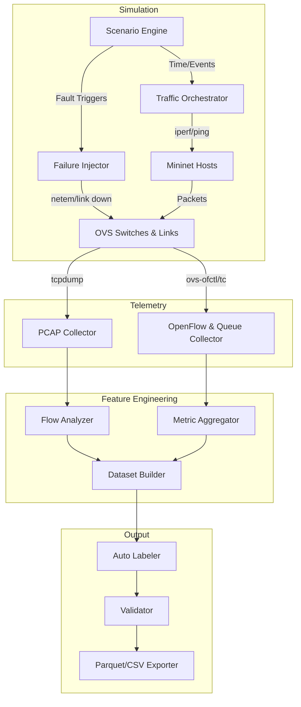

# RSNSD v3 — Production-Grade Network Telemetry Dataset Generator
**Complete Software Requirements Specification (SRS), Architecture Design Document (ADD), & Data Engineering Blueprint**

## 1. Executive Summary
This document specifies the ultimate architecture for a production-grade Network Telemetry Dataset Generator. Operating on a **Zero-Synthetic Assumption Policy**, the framework treats a live Mininet SDN deployment as a Digital Twin of a 5G network, extracting telemetry purely from measurable Linux/OVS physics.

---

## 2. Layer 1 — Research Objectives
The dataset solves specific ML tasks required for self-healing 5G networks:
- **Traffic Classification:** Distinguishing exact services (e.g., *Drone Imaging* vs *Telemedicine*) from aggregated OVS byte flows without Deep Packet Inspection.
- **Slice Allocation:** Predicting slice saturation (eMBB vs URLLC) and re-allocating OpenFlow queue weights dynamically.
- **QoS Prediction:** Predicting SLA violations (latency spikes > 10ms) seconds before they impact the UE.
- **Congestion Prediction:** Forecasting HTB queue overflow based on temporal burst patterns.
- **Failure Prediction:** Recognizing the early statistical signatures (e.g., MAC learning errors, ARP timeouts, micro-burst losses) of a dying link or failing switch.
- **Root Cause Analysis (RCA):** Classifying packet loss as either *Congestion-Induced*, *Hardware-Fault-Induced*, or *Misrouting-Induced*.
- **RL State Representation:** Providing a fully observable, Markovian state vector (Queue states, Flow Tables, Link BW) to Reinforcement Learning self-healing agents.

---

## 3. Layer 2 — Dataset Philosophy
**The network is the source of truth.** 
For every feature:
- **Why does it exist?** To expose internal network state to ML models.
- **Can Mininet measure it?** Yes, via OVS/Linux. (e.g., `queue_drops`)
- **If not, how is it derived?** End-to-end metrics (e.g., `jitter`) are derived mathematically from ingress/egress PCAP timestamp correlations.
- **Why estimate?** Environmental contexts (e.g., `weather="Rain"`) must be synthetically estimated to simulate their physical degradation on link capacities, because Mininet does not natively understand "Rain".
- **Why benefit ML?** It provides causal links (Rain -> Link Degradation -> Queue Build-up -> Retransmissions).

---

## 4. System Architecture: 25 Design Phases

### Phase 1: Research Objectives
- **Objective:** Define the ML tasks the dataset must solve.
- **Responsibilities:** Define the specific SLA thresholds and target classes.

### Phase 2: Software Architecture
- **Objective:** Orchestrate the entire digital twin loop.
- **Modules:** `MainOrchestrator`, `EngineRegistry`.

### Phase 3: Repository Layout (Layer 15)
- **Objective:** Strict segregation of concerns.
```text
RSNSDv3/
├── core/             # Orchestrator, Main loop
├── registries/       # Application, Feature, Scenario definitions (JSON/YAML)
├── simulation/       # Mininet topology, SDN controllers
├── traffic/          # iperf3, D-ITG, custom UDP sockets
├── scenario/         # FSM for state evolution
├── context/          # Weather, power, event simulation
├── fault/            # Link down, netem latency injection
├── telemetry/        # OpenFlow polling, tc, psutil, tcpdump
├── features/         # PCAP extraction, metric aggregation
├── qos/              # Latency, loss, jitter derivation
├── labels/           # SLA violation and RCA labeler
├── dataset/          # Time-synchronization and alignment
├── validation/       # Correlation, distribution checks
├── export/           # Parquet/CSV dumping
└── scripts/          # Execution wrappers
```

### Phase 4: Configuration Management
- **Objective:** Parse YAML registries to drive the simulation.
- **Inputs:** `topology.yaml`, `features.yaml`.

### Phase 5: Mininet Infrastructure
- **Objective:** Sandbox the environment.
- **Modules:** `MininetManager`, `OVSManager`.
- **Dependencies:** `mininet`, `openvswitch-switch`.

### Phase 6: Network Topology Engine
- **Objective:** Deploy the Rural 5G Architecture (Layer 5).
- **Topology Details:**
  - **Village (UEs):** `h_school`, `h_hospital`, `h_farm`, `h_police`, `h_home`.
  - **Rural Aggregation:** `s_rural_1`, `s_rural_2`. Link: 1Gbps, 2ms.
  - **Edge Cloud:** `s_edge`. Hosts MEC servers (`srv_mec`). Link: 10Gbps, 1ms.
  - **5G Core:** `s_core`. Hosts internet (`srv_core`). Link: 40Gbps, 10ms.
- **Queues:** Strict HTB queues mapped via OpenFlow for URLLC, eMBB, mMTC.

### Phase 7: Traffic Generation Engine
- **Objective:** Spawns real sockets.
- **Modules:** `TrafficOrchestrator`, `IperfEmulator`, `PingEmulator`.

### Phase 8: Application Registry (Layer 4)
Defines 35+ applications. Examples:
- **Healthcare (URLLC):** `ECG Streaming`, `Telesurgery`, `ICU Monitor`. Protocol: UDP/TCP. Packet: 100B-1500B. Latency tolerance: <5ms.
- **Agriculture (mMTC):** `Soil Sensor`, `Weather Station`, `Drone Video`. Burstiness: Periodic. Loss tolerance: High (except video).
- **Education (eMBB):** `VR Classroom`, `Lecture Stream`. Protocol: TCP. Load: Heavy downstream.
- **Government/Emergency:** `Police Dispatch`, `Fire Sensor`. Priority: Critical.

### Phase 9: Scenario Engine (Layer 8)
- **Objective:** Evolve the network logically.
- **Scenarios:** `Normal`, `School Hours`, `Harvest Season`, `Medical Emergency`, `Flood`, `Fiber Cut`, `Controller Failure`.
- **Trigger:** `ScenarioScheduler`. Duration: 1-4 hours (simulated).

### Phase 10: Context Engine
- **Objective:** Simulate external physical variables (Weather, Mobility).

### Phase 11: Failure Injection Framework
- **Objective:** Sabotage the data plane to capture anomaly metrics.
- **Modules:** `NetemInjector` (latency/loss), `LinkKiller` (ifconfig down), `CPUHog` (stress-ng).

### Phase 12: Telemetry Collection Engine
- **Objective:** Measure everything.
- **Modules & Mapping (Layer 10):**
  - Flow Counters -> `ovs-ofctl dump-flows`
  - Queue Stats -> `tc -s class show`
  - Link Status -> `ethtool`, `ip link`
  - CPU/Mem -> `/proc`, `psutil`
  - Packets -> `tcpdump`

### Phase 13: Feature Registry & Phase 14: Extraction
- **Objective:** Transform raw traces into ML schemas.
- **Provenance Pipeline (Layer 9):** E.g., App sends UDP -> OVS queues it -> `tcpdump` captures it -> `FlowAnalyzer` measures IAT -> Feature `mean_iat_ms`.

### Phase 15: QoS Derivation Engine
- **Objective:** Calculate exact SLAs (Latency, Jitter, Goodput).

### Phase 16: Label Generation Engine (Layer 12)
- **Objective:** No manual labeling.
- **Labels:** `Congestion_Status`, `Fault_Type` (e.g. "FIBER_CUT"), `SLA_Violated` (Boolean based on measured latency vs Application Registry threshold).

### Phase 17: Dataset Builder & Phase 11: Sampling Engine
- **Objective:** Align asynchronous telemetry.
- **Sampling Engine:** 1000ms global tick. Sliding windows aggregate PCAP stats into rolling 1-second means/stdevs.

### Phase 18: Dataset Validation
- **Objective:** Enforce physical laws.
- **Validation Rules (Layer 13):** `retransmissions` <= `total_packets`. `queue_drop` correlates positively with `network_load`.

### Phase 19: Dataset Versioning & Phase 20: Export
- **Objective:** Git-like tracking of data. Export to Parquet/HDF5.

### Phase 21-25: Statistics, Experiments, Visuals, Testing, Reproducibility
- Generates PCA plots, Mutual Information scores, class balance reports, and CI/CD testing frameworks.

---

## 5. Layer 3 — Complete Dataset Schema (Feature Registry Example)

```yaml
Feature_ID: F_OVS_001
Feature_Name: flow_byte_rate_bps
Description: Instantaneous byte rate of an OpenFlow rule.
Units: Bits per second (bps)
Datatype: Float64
Expected_Range: [0.0, 40000000000.0]
Sampling_Interval: 1000ms
Source_Module: TelemetryEngine (OVS Collector)
Origin: Measured
Dependencies: ovs-ofctl
Applicable_Applications: All
Importance_Score: High
Related_Features: [queue_occupancy_bytes]
Validation_Rule: Must be >= 0 and <= Link_Capacity
Storage_Format: Parquet Float64
Normalization_Strategy: Min-Max (0-1) based on theoretical link max.
```
*(The schema generator loops over 100+ such YAML entries to build the Pandas DataFrame schema dynamically).*

---

## 6. Layer 17 — UML Specifications

### Pipeline Data Flow Diagram (DFD)


---

## 7. Layer 19 — Future Extensions
Because the framework extracts features from generic network interfaces (PCAPs, OpenFlow), transitioning from Mininet to a real 5G testbed is seamless:
1. **ns-3 / UERANSIM:** Replace `TrafficOrchestrator` to interface with UERANSIM UE instances. Telemetry collectors attach to the GTP-U interfaces.
2. **Open5GS:** Deploy the 5G core on Docker. Point `TelemetryEngine` to the UPF interfaces.
3. **Real SDR Testbed:** Attach hardware USRPs to the OVS switches. The dataset pipeline remains 100% untouched, processing real hardware traces identically to simulated traces.
