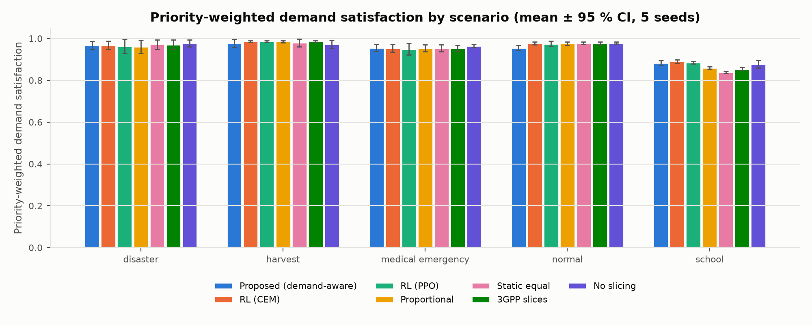
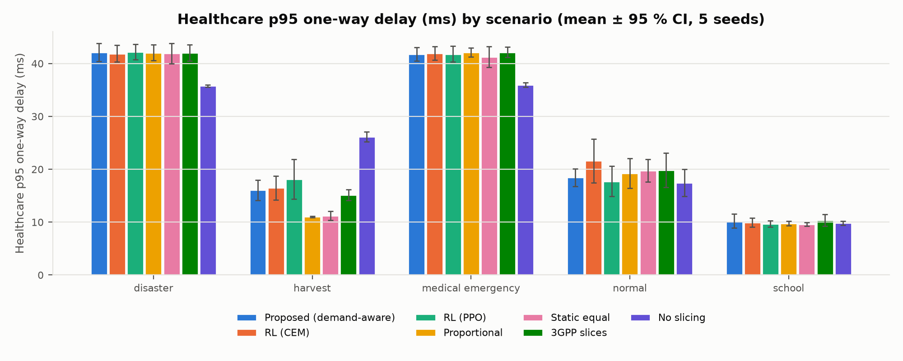
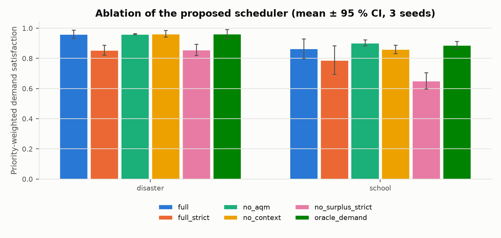
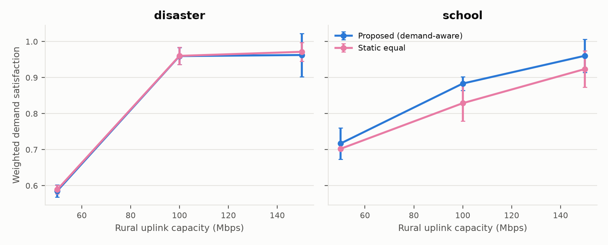
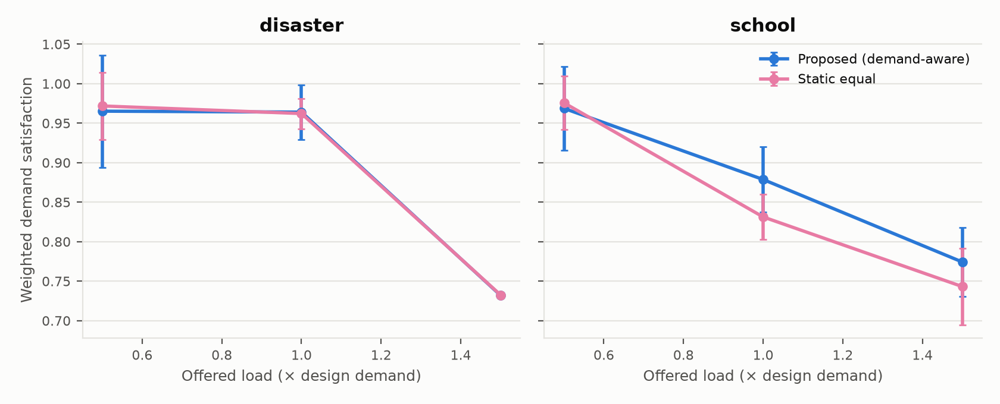
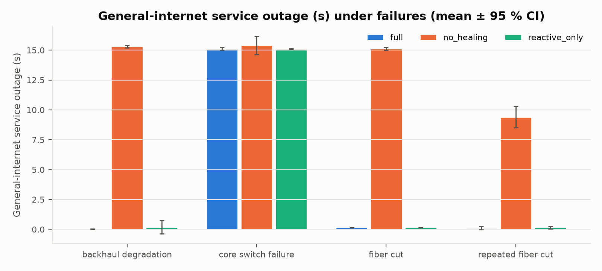
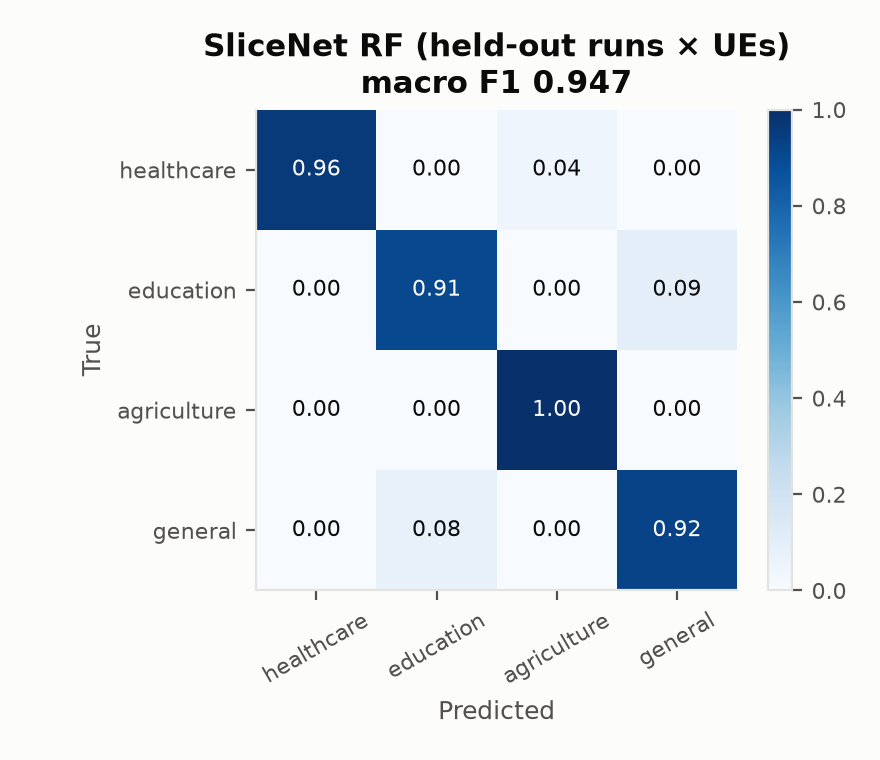
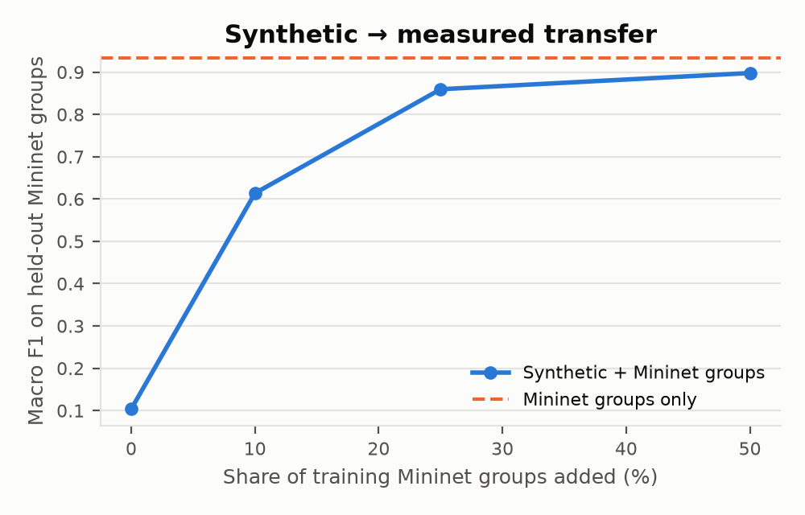
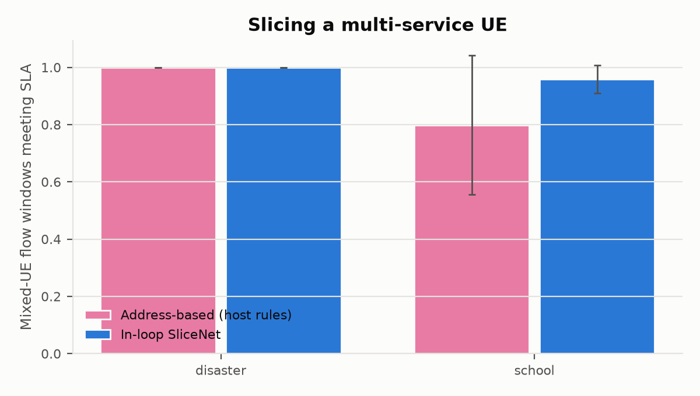
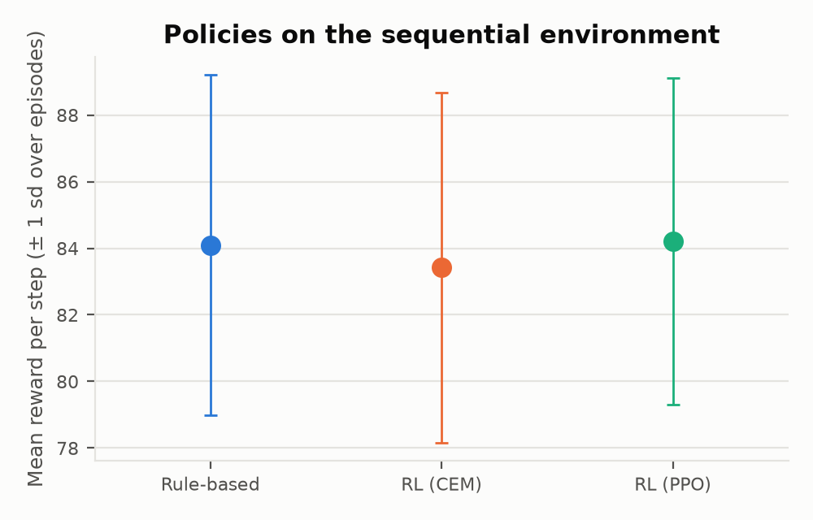

# Results

Generated by `experiments/report.py` from `results/tables/` (see [research_design.md](research_design.md) for the hypotheses and method). Every number is measured on the emulated network unless stated otherwise.

## Hypotheses

654 runs (main 200, qos_capacity 60, qos_emergency 60, qos_load 60, qos_transitions 60, ablation 36, resilience 36, sensitivity_capacity 36, sensitivity_load 36, qos_slicenet 20, slicenet_inloop 12, online_rl 10, qos_online 10, scalability 9, timeline 9); 654 with packet-level measurements; median validation score 84/100.

| Hypothesis | Verdict | Evidence |
|---|---|---|
| H1a | **Not supported** | proposed vs tgpp / static_equal / no_slicing on weighted utility: False, False, False |
| H1b | **Not supported** | high-load healthcare p95 lower than tgpp/no_slicing: [False, False]; significant: [False, False] |
| H2 | **Not supported** | disaster/no_aqm: no loss; disaster/no_context: no loss; disaster/no_surplus_strict: no loss; school/no_aqm: no loss; school/no_context: worse; school/no_surplus_strict: worse |
| H3 | **Supported** | proposed − rl_ppo = -0.0042 (p = 0.3602); proposed − rl_cem = -0.0074 (p = 0.0177) |
| H4a | **Supported** | fiber cut, full healing: max outage per run [0.166, 0.158, 0.17] s |
| H4b | **Supported** | switched before cut in 100% of runs; mean outage predictive 0.019 s vs reactive 0.214 s |
| H5a | **Supported** | best held-out macro F1 = 0.9471 |
| H5b | **Not supported** | SliceNet > host-based in 1/2 scenarios |
| H6 | **Supported** | zero-shot F1 0.1036, with 50% measured groups 0.8978 |
| H7 | **Not supported** | proposed ≥ static_equal in 6/12 capacity/load settings |
| H8 | **Supported** | mean healthcare p95 by scenario: disaster: 349.0 vs 797.9 ms; school: 4.5 vs 5.4 ms |
| H9 | **Not supported** | proposed − context_unaware weighted utility -0.0016 (p = 0.3967, n = 25); healthcare SLA share Δ -0.0006 (p = 0.5807) |
| H10 | **Supported** | full − no_healing outage: education_outage_s -9.820 s (p = 0.0010); general_outage_s -9.957 s (p = 0.0010) |
| H11 | **Not supported** | qos_adaptive − proposed: mean class SLA -0.0155 (p = 0.0050, n = 40); worst class SLA +0.0254 (p = 0.2279, n = 40) |
| H12 | **Not supported** | qos_adaptive − rl_residual: mean class SLA +0.0022 (p = 0.1991, n = 40) (negative = RL higher) |
| H13 | **Not supported** | qos_adaptive − qos_aware: mean class SLA -0.0013 (p = 0.6810, n = 40) |
| H14 | **Supported** | host − slicenet_all mean class SLA -0.0023 (p = 0.6758, n = 10); margin 0.02 |
| FC1 | **Not supported** | qos_adaptive vs proposed on healthcare_sla_satisfied_share: Δ 0.0432 [-0.0062, 0.0926], r = 0.374, p_holm = 0.584556 |
| FC2 | **Not supported** | qos_adaptive vs proposed on min_class_sla: Δ -0.0003 [-0.0227, 0.0221], r = 0.128, p_holm = nan |
| FC3a | **Supported** | qos_aware vs qos_blind on healthcare_sla_satisfied_share: Δ 0.0315 [0.0127, 0.0503], r = 0.801, p_holm = 0.022664 |
| FC3b | **Not supported** | qos_aware vs qos_blind on transient_mean_class_sla: Δ -0.0007 [-0.0231, 0.0218], r = 0.018, p_holm = 1.0 |
| FC4 | **Supported** | qos_adaptive vs qos_blind on mean_class_sla: Δ 0.001 [-0.0021, 0.0042], r = 0.357, p_holm = nan |
| FC5 | **Not supported** | qos_reactive vs qos_aware on transient_mean_class_sla: Δ 0.0021 [-0.0025, 0.0068], r = 0.267, p_holm = 1.0 |
| FC6a | **Not supported** | qos_adaptive vs qos_reactive on transient_mean_class_sla: Δ -0.0018 [-0.0068, 0.0033], r = -0.143, p_holm = 1.0 |
| FC6b | **Not supported** | qos_adaptive vs qos_reactive on mean_class_sla: Δ -0.0009 [-0.0049, 0.0032], r = -0.078, p_holm = 1.0 |
| FC7 | **Not supported** | rl_residual vs qos_adaptive on mean_class_sla: Δ 0.0008 [-0.0045, 0.0061], r = 0.044, p_holm = 1.0 |
| FC8 | **Not supported** | rl_residual_safe vs qos_adaptive on mean_class_sla: Δ -0.0003 [-0.0037, 0.0032], r = -0.017, p_holm = 1.0 |
| FC9 | **Supported** | rl_residual_online vs rl_residual_online_nolearn on mean_class_sla: Δ 0.054 [0.0431, 0.0649], r = 1.0, p_holm = 0.017577 |
| FC10 | **Supported** | slicenet_all vs host on mean_class_sla: Δ -0.0039 [-0.0141, 0.0064], r = -0.309, p_holm = nan |
| FC11 | **Supported** | full vs no_healing on core_outage_s: Δ -9.9554 [-13.9873, -5.9235], r = -0.974, p_holm = 0.00977 |

## RQ1/RQ3 — Scheduler comparison (main study)

Mean across the five contexts (per-context values with 95 % CIs are in `results/tables/main_summary.csv`):

| scheduler | weighted utility | healthcare p95 (ms) | healthcare SLA share | Jain fairness |
|---|---|---|---|---|
| context_unaware | 0.949 | 25.429 | 0.891 | 0.986 |
| no_slicing | 0.954 | 25.034 | 0.773 | 0.994 |
| proportional | 0.947 | 24.844 | 0.894 | 0.991 |
| proposed | 0.948 | 25.729 | 0.890 | 0.984 |
| rl_cem | 0.955 | 26.361 | 0.888 | 0.982 |
| rl_ppo | 0.952 | 25.909 | 0.893 | 0.984 |
| static_equal | 0.944 | 24.756 | 0.884 | 0.992 |
| tgpp | 0.948 | 25.897 | 0.883 | 0.991 |

Paired Wilcoxon signed-rank tests, proposed vs each baseline, on (scenario, seed) pairs:

| baseline | metric | pairs | proposed_mean | baseline_mean | mean_difference | wilcoxon_p | significant_0.05 | significant_bonferroni |
|---|---|---|---|---|---|---|---|---|
| context_unaware | weighted_utility | 25 | 0.9476 | 0.9492 | -0.0016 | 0.396657 | False | False |
| context_unaware | healthcare_latency_p95_ms | 25 | 25.7287 | 25.4293 | 0.2994 | 0.103537 | False | False |
| context_unaware | healthcare_sla_satisfied_share | 25 | 0.8903 | 0.891 | -0.0006 | 0.580712 | False | False |
| no_slicing | weighted_utility | 25 | 0.9476 | 0.9542 | -0.0066 | 0.028828 | True | False |
| no_slicing | healthcare_latency_p95_ms | 25 | 25.7287 | 25.0339 | 0.6948 | 0.366585 | False | False |
| no_slicing | healthcare_sla_satisfied_share | 25 | 0.8903 | 0.7731 | 0.1173 | 0.000979 | True | True |
| proportional | weighted_utility | 25 | 0.9476 | 0.9473 | 0.0003 | 0.716411 | False | False |
| proportional | healthcare_latency_p95_ms | 25 | 25.7287 | 24.8441 | 0.8846 | 0.23643 | False | False |
| proportional | healthcare_sla_satisfied_share | 25 | 0.8903 | 0.8943 | -0.004 | 0.136217 | False | False |
| rl_cem | weighted_utility | 25 | 0.9476 | 0.9549 | -0.0074 | 0.017719 | True | False |
| rl_cem | healthcare_latency_p95_ms | 25 | 25.7287 | 26.3613 | -0.6326 | 0.299612 | False | False |
| rl_cem | healthcare_sla_satisfied_share | 25 | 0.8903 | 0.8885 | 0.0019 | 0.458088 | False | False |
| rl_ppo | weighted_utility | 25 | 0.9476 | 0.9517 | -0.0042 | 0.360235 | False | False |
| rl_ppo | healthcare_latency_p95_ms | 25 | 25.7287 | 25.9093 | -0.1806 | 0.791476 | False | False |
| rl_ppo | healthcare_sla_satisfied_share | 25 | 0.8903 | 0.8932 | -0.0029 | 0.138011 | False | False |
| static_equal | weighted_utility | 25 | 0.9476 | 0.9443 | 0.0033 | 0.587228 | False | False |
| static_equal | healthcare_latency_p95_ms | 25 | 25.7287 | 24.7555 | 0.9732 | 0.018745 | True | False |
| static_equal | healthcare_sla_satisfied_share | 25 | 0.8903 | 0.884 | 0.0063 | 0.483303 | False | False |
| tgpp | weighted_utility | 25 | 0.9476 | 0.9481 | -0.0005 | 0.914287 | False | False |
| tgpp | healthcare_latency_p95_ms | 25 | 25.7287 | 25.8974 | -0.1687 | 0.791476 | False | False |
| tgpp | healthcare_sla_satisfied_share | 25 | 0.8903 | 0.8828 | 0.0075 | 0.17156 | False | False |

**Exploratory finding (not a pre-registered hypothesis).** Differences in healthcare SLA-met share that survive Bonferroni correction:

* proposed vs no_slicing: 0.890 vs 0.773 (Δ +0.117, p = 0.0010, n = 25 pairs)

## RQ2 — Ablation

| scenario | variant | n | weighted_utility_mean | weighted_utility_ci95 | healthcare_latency_p95_ms_mean | healthcare_latency_p95_ms_ci95 |
|---|---|---|---|---|---|---|
| disaster | full | 3 | 0.962 | 0.027 | 40.873 | 7.707 |
| disaster | full_strict | 3 | 0.855 | 0.033 | 45.142 | 5.44 |
| disaster | no_aqm | 3 | 0.961 | 0.003 | 35.552 | 1.282 |
| disaster | no_context | 3 | 0.963 | 0.022 | 42.292 | 3.261 |
| disaster | no_surplus_strict | 3 | 0.857 | 0.037 | 44.472 | 3.018 |
| disaster | oracle_demand | 3 | 0.962 | 0.03 | 41.7 | 5.47 |
| school | full | 3 | 0.865 | 0.065 | 9.996 | 1.669 |
| school | full_strict | 3 | 0.789 | 0.095 | 165.049 | 45.382 |
| school | no_aqm | 3 | 0.903 | 0.02 | 9.41 | 0.21 |
| school | no_context | 3 | 0.861 | 0.028 | 10.384 | 2.234 |
| school | no_surplus_strict | 3 | 0.652 | 0.054 | 154.179 | 43.487 |
| school | oracle_demand | 3 | 0.889 | 0.024 | 10.083 | 1.567 |

## RQ7 — Sensitivity Capacity

| scenario | scheduler | capacity_mbps | weighted_utility_mean | weighted_utility_ci95 |
|---|---|---|---|---|
| disaster | proposed | 50 | 0.586 | 0.017 |
| disaster | proposed | 100 | 0.96 | 0.024 |
| disaster | proposed | 150 | 0.963 | 0.06 |
| disaster | static_equal | 50 | 0.589 | 0.012 |
| disaster | static_equal | 100 | 0.96 | 0.024 |
| disaster | static_equal | 150 | 0.972 | 0.026 |
| school | proposed | 50 | 0.717 | 0.044 |
| school | proposed | 100 | 0.883 | 0.019 |
| school | proposed | 150 | 0.96 | 0.046 |
| school | static_equal | 50 | 0.702 | 0.005 |
| school | static_equal | 100 | 0.829 | 0.05 |
| school | static_equal | 150 | 0.924 | 0.051 |

## RQ7 — Sensitivity Load

| scenario | scheduler | load_scale | weighted_utility_mean | weighted_utility_ci95 |
|---|---|---|---|---|
| disaster | proposed | 0.5 | 0.965 | 0.071 |
| disaster | proposed | 1.0 | 0.964 | 0.035 |
| disaster | proposed | 1.5 | 0.732 | 0.003 |
| disaster | static_equal | 0.5 | 0.972 | 0.042 |
| disaster | static_equal | 1.0 | 0.962 | 0.019 |
| disaster | static_equal | 1.5 | 0.732 | 0.001 |
| school | proposed | 0.5 | 0.969 | 0.053 |
| school | proposed | 1.0 | 0.879 | 0.042 |
| school | proposed | 1.5 | 0.774 | 0.043 |
| school | static_equal | 0.5 | 0.976 | 0.034 |
| school | static_equal | 1.0 | 0.831 | 0.028 |
| school | static_equal | 1.5 | 0.743 | 0.048 |

## Scalability (UEs per service)

| ues_per_service | n | weighted_utility_mean | weighted_utility_ci95 | healthcare_latency_p95_ms_mean |
|---|---|---|---|---|
| 1.0 | 3.0 | 0.852 | 0.021 | 11.947 |
| 2.0 | 3.0 | 0.885 | 0.031 | 9.44 |
| 4.0 | 3.0 | 0.889 | 0.03 | 8.794 |

## RQ4 — Resilience

| scenario | variant | n | res_mttd_s_mean | res_mttr_control_s_mean | education_outage_s_mean | general_outage_s_mean | general_failover_lost_mean | weighted_utility_mean |
|---|---|---|---|---|---|---|---|---|
| backhaul_degradation | full | 3 | 15.003 | 15.056 | 0.01 | 0.019 | 23.0 | 0.951 |
| backhaul_degradation | no_healing | 3 | nan | nan | 15.126 | 15.31 | 520.0 | 0.816 |
| backhaul_degradation | reactive_only | 3 | 21.996 | 22.013 | 0.075 | 0.184 | 231.0 | 0.96 |
| core_switch_failure | full | 3 | 0.0 | 0.016 | 15.116 | 15.115 | 164.0 | 0.953 |
| core_switch_failure | no_healing | 3 | nan | nan | 15.32 | 15.404 | 180.667 | 0.954 |
| core_switch_failure | reactive_only | 3 | 0.007 | 0.04 | 15.113 | 15.113 | 179.333 | 0.947 |
| fiber_cut | full | 3 | 0.002 | 0.031 | 0.063 | 0.165 | 109.0 | 0.964 |
| fiber_cut | no_healing | 3 | nan | nan | 15.049 | 15.126 | 188.333 | 0.942 |
| fiber_cut | reactive_only | 3 | 0.0 | 0.028 | 0.072 | 0.16 | 112.0 | 0.972 |
| repeated_fiber_cut | full | 3 | 0.0 | 0.018 | 0.062 | 0.117 | 114.333 | 0.959 |
| repeated_fiber_cut | no_healing | 3 | nan | nan | 9.034 | 9.404 | 186.667 | 0.871 |
| repeated_fiber_cut | reactive_only | 3 | 0.0 | 0.02 | 0.061 | 0.155 | 115.0 | 0.964 |

Post-recovery verification (full healing): 25 recoveries verified, 0 unverified, 3 escalations across 12 runs; median time to verified restore 1.965 s.

Paired tests, full healing vs each variant on (scenario, seed) pairs (negative difference = full healing lower):

| baseline | metric | pairs | full_mean | baseline_mean | mean_difference | wilcoxon_p |
|---|---|---|---|---|---|---|
| no_healing | education_outage_s | 12 | 3.8126 | 13.6322 | -9.8197 | 0.000977 |
| no_healing | general_outage_s | 12 | 3.854 | 13.8109 | -9.9569 | 0.000977 |
| no_healing | education_failover_lost | 12 | 39.0833 | 4807.0 | -4767.9167 | 0.000488 |
| no_healing | general_failover_lost | 12 | 102.5833 | 268.9167 | -166.3333 | 0.000977 |
| no_healing | weighted_utility | 12 | 0.9568 | 0.8957 | 0.0611 | 0.004883 |
| reactive_only | education_outage_s | 12 | 3.8126 | 3.8301 | -0.0175 | 0.169922 |
| reactive_only | general_outage_s | 12 | 3.854 | 3.9028 | -0.0488 | 0.431641 |
| reactive_only | education_failover_lost | 12 | 39.0833 | 88.5 | -49.4167 | 0.017578 |
| reactive_only | general_failover_lost | 12 | 102.5833 | 159.3333 | -56.75 | 0.210449 |
| reactive_only | res_mttr_control_s | 12 | 3.7802 | 5.5252 | -1.745 | 0.026367 |
| reactive_only | weighted_utility | 12 | 0.9568 | 0.9609 | -0.0041 | 0.063965 |
| reactive_only | time_to_restore_s | 12 | 1.3218 | 1.4936 | -0.1718 | 0.478516 |

## RQ5/RQ6 — SliceNet

Measured dataset: 4697 flow windows from 18 runs; evaluation holds out whole run × UE groups.

| model | macro F1 | accuracy | test windows | healthcare | education | agriculture | general |
|---|---|---|---|---|---|---|---|
| random_forest | 0.9471 | 0.9395 | 1207 | 0.979 | 0.902 | 0.981 | 0.926 |
| cnn_1d | 0.858 | 0.8575 | 1207 | 0.882 | 0.793 | 0.884 | 0.873 |

| mininet_fraction | mininet_groups | f1_macro |
|---|---|---|
| 0.0 | 0.0 | 0.1036 |
| 0.1 | 7.0 | 0.6138 |
| 0.25 | 18.0 | 0.8595 |
| 0.5 | 36.0 | 0.8978 |

Measured-only (same shared columns): macro F1 0.9339.

### In-loop slicing of a mixed-service UE

| scenario | classification | n | mixed_sla_share_mean | mixed_sla_share_ci95 | online_accuracy_mean | mixed_healthcare_sla_share_mean |
|---|---|---|---|---|---|---|
| disaster | host | 3 | 1.0 | 0.0 | nan | 1.0 |
| disaster | slicenet | 3 | 1.0 | 0.0 | 0.833 | 1.0 |
| school | host | 3 | 0.798 | 0.243 | nan | 1.0 |
| school | slicenet | 3 | 0.958 | 0.049 | 0.75 | 1.0 |

## Learning engine on the sequential environment (simulation)

Held-out evaluation seeds (disjoint from training and validation seeds), 30 episodes × 120 steps, shared reward:

| policy | mean_reward | std_reward | sla_violations_per_episode | mean_satisfaction |
|---|---|---|---|---|
| rule_based | 9139.32 | 879.63 | 139.9 | 0.8985 |
| rl_cem | 9479.74 | 778.53 | 108.67 | 0.9149 |
| rl_ppo | 9414.78 | 808.28 | 116.37 | 0.916 |

Paired over the same episodes (policy − rule-based):

| policy | episodes | mean_diff | ci95 | relative_pct | wilcoxon_p | wins | losses |
|---|---|---|---|---|---|---|---|
| rl_cem | 30 | 340.416 | [282.847, 397.986] | 3.725 | 0.0 | 30 | 0 |
| rl_ppo | 30 | 275.455 | [203.154, 347.756] | 3.014 | 0.0 | 26 | 4 |

PPO seeds [0, 1, 2]: test reward 9388.84 ± 20.25 (per seed {'0': 9386.4, '1': 9365.35, '2': 9414.78}); deployed seed 2 (best validation score).

## Mininet online learning (online CEM, consecutive live runs)

Exploratory: the policy starts from the simulator-trained CEM policy and updates only from live transitions whose allocation was verified in the kernel. Runs are sequential, so the trend mixes learning with seed effects.

| scenario | seed | rl_transitions | rl_transition_mean_reward | weighted_utility | enforcement_failed |
|---|---|---|---|---|---|
| disaster | 0 | 16 | 84.34 | 0.986 | 0 |
| disaster | 1 | 22 | 90.165 | 0.97 | 0 |
| disaster | 2 | 16 | 90.499 | 0.972 | 0 |
| disaster | 3 | 17 | 89.856 | 0.992 | 0 |
| disaster | 4 | 19 | 85.595 | 0.974 | 0 |
| school | 0 | 21 | 84.594 | 0.867 | 0 |
| school | 1 | 19 | 83.312 | 0.86 | 0 |
| school | 2 | 23 | 83.947 | 0.853 | 0 |
| school | 3 | 22 | 84.674 | 0.867 | 0 |
| school | 4 | 22 | 86.593 | 0.868 | 0 |

## QoS-targeted control in contended regimes (modules A–F)

Emergencies at 100 Mb/s, school/harvest at 50 Mb/s, school/disaster at 1.5× load and two context timelines; 5 seeds; paired by (condition, seed). *Mean class SLA* = mean over the four slices of the share of flow windows meeting the application's SLA; *worst class SLA* = the lowest of the four.

Mean over the eight conditions (per-condition values with 95 % CIs: `results/tables/qos_summary.csv`):

| scheduler | mean class SLA | worst class SLA | healthcare SLA | agriculture SLA | healthcare loss % | weighted utility | allocation changes |
|---|---|---|---|---|---|---|---|
| context_unaware | 0.936 | 0.759 | 0.837 | 0.968 | 1.073 | 0.858 | 11.950 |
| proposed | 0.935 | 0.759 | 0.831 | 0.967 | 1.157 | 0.861 | 9.250 |
| qos_adaptive | 0.919 | 0.785 | 0.900 | 0.858 | 0.261 | 0.860 | 10.525 |
| qos_aware | 0.921 | 0.791 | 0.902 | 0.861 | 0.279 | 0.860 | 9.475 |
| rl_residual | 0.917 | 0.774 | 0.897 | 0.855 | 0.278 | 0.858 | 10.450 |
| static_equal | 0.929 | 0.731 | 0.833 | 0.968 | 1.199 | 0.850 | 1.000 |

Mean class SLA per condition:

| condition | context_unaware | proposed | qos_adaptive | qos_aware | rl_residual | static_equal |
|---|---|---|---|---|---|---|
| disaster | 0.946 | 0.944 | 0.93 | 0.947 | 0.924 | 0.942 |
| disaster@1.5x | 0.876 | 0.872 | 0.788 | 0.781 | 0.788 | 0.875 |
| harvest@50Mbps | 0.932 | 0.93 | 0.981 | 0.985 | 0.98 | 0.928 |
| medical_emergency | 0.922 | 0.918 | 0.894 | 0.893 | 0.895 | 0.92 |
| medical_night | 0.948 | 0.947 | 0.933 | 0.933 | 0.934 | 0.949 |
| rural_day | 0.975 | 0.969 | 0.959 | 0.956 | 0.946 | 0.962 |
| school@1.5x | 0.965 | 0.98 | 0.967 | 0.965 | 0.966 | 0.935 |
| school@50Mbps | 0.926 | 0.921 | 0.902 | 0.905 | 0.906 | 0.925 |

Paired Wilcoxon tests, `qos_adaptive` vs each scheduler (positive difference = qos_adaptive higher):

| baseline | metric | pairs | qos_adaptive_mean | baseline_mean | mean_difference | wilcoxon_p | significant_0.05 | significant_bonferroni |
|---|---|---|---|---|---|---|---|---|
| context_unaware | mean_class_sla | 40 | 0.9195 | 0.9362 | -0.0167 | 0.006367 | True | False |
| context_unaware | min_class_sla | 40 | 0.7846 | 0.759 | 0.0256 | 0.211889 | False | False |
| context_unaware | healthcare_sla_satisfied_share | 40 | 0.9004 | 0.8367 | 0.0637 | 0.000225 | True | True |
| context_unaware | transient_mean_class_sla | 10 | 0.9424 | 0.9584 | -0.016 | 0.001953 | True | False |
| proposed | mean_class_sla | 40 | 0.9195 | 0.935 | -0.0155 | 0.004965 | True | False |
| proposed | min_class_sla | 40 | 0.7846 | 0.7592 | 0.0254 | 0.227916 | False | False |
| proposed | healthcare_sla_satisfied_share | 40 | 0.9004 | 0.8308 | 0.0695 | 0.000176 | True | True |
| proposed | transient_mean_class_sla | 10 | 0.9424 | 0.9566 | -0.0142 | 0.037109 | True | False |
| qos_aware | mean_class_sla | 40 | 0.9195 | 0.9208 | -0.0013 | 0.680969 | False | False |
| qos_aware | min_class_sla | 40 | 0.7846 | 0.7908 | -0.0062 | 0.351898 | False | False |
| qos_aware | healthcare_sla_satisfied_share | 40 | 0.9004 | 0.9023 | -0.002 | 0.476856 | False | False |
| qos_aware | transient_mean_class_sla | 10 | 0.9424 | 0.9398 | 0.0026 | 0.59375 | False | False |
| rl_residual | mean_class_sla | 40 | 0.9195 | 0.9173 | 0.0022 | 0.199108 | False | False |
| rl_residual | min_class_sla | 40 | 0.7846 | 0.7744 | 0.0102 | 0.103595 | False | False |
| rl_residual | healthcare_sla_satisfied_share | 40 | 0.9004 | 0.8969 | 0.0035 | 0.392362 | False | False |
| rl_residual | transient_mean_class_sla | 10 | 0.9424 | 0.9347 | 0.0077 | 0.382812 | False | False |
| static_equal | mean_class_sla | 40 | 0.9195 | 0.9295 | -0.01 | 0.228957 | False | False |
| static_equal | min_class_sla | 40 | 0.7846 | 0.7306 | 0.054 | 0.00049 | True | True |
| static_equal | healthcare_sla_satisfied_share | 40 | 0.9004 | 0.8328 | 0.0676 | 0.000188 | True | True |
| static_equal | transient_mean_class_sla | 10 | 0.9424 | 0.9542 | -0.0118 | 0.027344 | True | False |

SliceNet classifying every flow vs address rules (same `qos_adaptive` controller):

| classification | metric | pairs | host_mean | slicenet_all_mean | mean_difference | wilcoxon_p |
|---|---|---|---|---|---|---|
| slicenet_all | mean_class_sla | 10 | 0.9557 | 0.9581 | -0.0023 | 0.675781 |
| slicenet_all | min_class_sla | 10 | 0.862 | 0.8768 | -0.0149 | 0.3125 |
| slicenet_all | healthcare_sla_satisfied_share | 10 | 0.9609 | 0.957 | 0.004 | 0.875 |
| slicenet_all | education_sla_satisfied_share | 10 | 1.0 | 0.9938 | 0.0062 | 0.5 |
| slicenet_all | agriculture_sla_satisfied_share | 10 | 0.897 | 0.8971 | -0.0001 | 1.0 |
| slicenet_all | general_sla_satisfied_share | 10 | 0.9649 | 0.9844 | -0.0195 | 0.3125 |

### Earlier evaluation v1 (seeds 0–4) and what it exposed

contended-regime v1 (seeds 0-4). Defects found and fixed (with regression tests) before the next run on fresh seeds:

* strict-priority degradation starves best-effort TCP (general SLA 0.0 at school@50Mbps and school@1.5x)
* infeasible branch ignores burst headroom, so the loss loop cannot act on overloaded directions (healthcare 0.76 at harvest@50Mbps)

v1 paired tests (qos_adaptive − baseline):

| baseline | metric | pairs | mean_difference | wilcoxon_p |
|---|---|---|---|---|
| context_unaware | mean_class_sla | 40 | -0.0742 | 0.0 |
| context_unaware | min_class_sla | 40 | -0.1872 | 0.3205 |
| proposed | mean_class_sla | 40 | -0.0746 | 0.0 |
| proposed | min_class_sla | 40 | -0.1887 | 0.6352 |
| qos_aware | mean_class_sla | 40 | 0.0014 | 0.6186 |
| qos_aware | min_class_sla | 40 | -0.0051 | 0.523 |
| rl_residual | mean_class_sla | 40 | -0.0011 | 0.4822 |
| rl_residual | min_class_sla | 40 | -0.0142 | 0.1676 |
| static_equal | mean_class_sla | 40 | -0.0697 | 0.0 |
| static_equal | min_class_sla | 40 | -0.1662 | 0.554 |

### Earlier evaluation v2 (seeds 5–9) and what it exposed

contended-regime v2 (seeds 5-9), after v1 fixes. Defects found and fixed (with regression tests) before the next run on fresh seeds:

* elastic (TCP) demand-estimate death spiral: a starved TCP slice sends less, the per-direction estimate follows it down and the anti-starvation guard (20 % of that estimate) collapses with it (general SLA 0.05 at school@50Mbps, 0.10 at school@1.5x)
* not changed: agriculture degraded in emergencies (0.78 vs 1.00 in disaster): declared context priority healthcare 10 : agriculture 1 gives burst room to healthcare (+0.09 to +0.17); reported as a policy trade-off, not tuned

v2 paired tests (qos_adaptive − baseline):

| baseline | metric | pairs | mean_difference | wilcoxon_p |
|---|---|---|---|---|
| context_unaware | mean_class_sla | 40 | -0.069 | 0.0001 |
| context_unaware | min_class_sla | 40 | -0.1571 | 0.2259 |
| proposed | mean_class_sla | 40 | -0.0684 | 0.0 |
| proposed | min_class_sla | 40 | -0.1543 | 0.2525 |
| qos_aware | mean_class_sla | 40 | 0.0008 | 0.8827 |
| qos_aware | min_class_sla | 40 | 0.0056 | 0.4051 |
| rl_residual | mean_class_sla | 40 | 0.0052 | 0.0103 |
| rl_residual | min_class_sla | 40 | 0.027 | 0.0004 |
| static_equal | mean_class_sla | 40 | -0.0643 | 0.0001 |
| static_equal | min_class_sla | 40 | -0.1343 | 0.293 |

### Earlier evaluation v3 (seeds 10–14) and what it exposed

contended-regime v3 (seeds 10-14), after v2 fix. Defects found and fixed (with regression tests) before the next run on fresh seeds:

* residual RL could take capacity from a slice down to its plain floor, overriding the heuristic anti-starvation guard: rl_residual starved general (SLA 0.04) at school@50Mbps and school@1.5x; the simulator models starved TCP as backing off smoothly, so the policy learned that starving it is cheap
* not changed: agriculture degraded in emergencies (declared context priority); unchanged

v3 paired tests (qos_adaptive − baseline):

| baseline | metric | pairs | mean_difference | wilcoxon_p |
|---|---|---|---|---|
| context_unaware | mean_class_sla | 40 | -0.0165 | 0.0044 |
| context_unaware | min_class_sla | 40 | 0.0357 | 0.0251 |
| proposed | mean_class_sla | 40 | -0.0168 | 0.0027 |
| proposed | min_class_sla | 40 | 0.0333 | 0.0048 |
| qos_aware | mean_class_sla | 40 | -0.002 | 0.3168 |
| qos_aware | min_class_sla | 40 | -0.0068 | 0.1255 |
| rl_residual | mean_class_sla | 40 | 0.0511 | 0.0085 |
| rl_residual | min_class_sla | 40 | 0.2013 | 0.0004 |
| static_equal | mean_class_sla | 40 | -0.0136 | 0.0285 |
| static_equal | min_class_sla | 40 | 0.0505 | 0.0003 |

Online residual RL across consecutive live runs (shared checkpoint):

| condition | seed | rl_transitions | rl_transition_mean_reward | mean_class_sla | min_class_sla | enforcement_failed |
|---|---|---|---|---|---|---|
| disaster | 15 | 24 | 92.094 | 0.966 | 0.865 | 0 |
| disaster | 16 | 27 | 94.844 | 1.0 | 1.0 | 0 |
| disaster | 17 | 26 | 93.938 | 0.969 | 0.875 | 0 |
| disaster | 18 | 30 | 92.733 | 0.956 | 0.823 | 0 |
| disaster | 19 | 28 | 91.977 | 0.94 | 0.76 | 0 |
| medical_emergency | 15 | 26 | 87.506 | 0.948 | 0.792 | 0 |
| medical_emergency | 16 | 25 | 90.669 | 0.992 | 0.969 | 0 |
| medical_emergency | 17 | 28 | 86.835 | 0.958 | 0.833 | 0 |
| medical_emergency | 18 | 27 | 88.315 | 0.938 | 0.75 | 0 |
| medical_emergency | 19 | 26 | 87.661 | 0.914 | 0.656 | 0 |

## Final evaluation (predeclared; fresh seeds 20–24)

Plan: [final_evaluation_plan.md](final_evaluation_plan.md). Paired by (condition, seed); two-sided Wilcoxon, mean difference with 95 % CI, matched-pairs rank-biserial r; Holm correction over the primary family.

| claim | statement | comparison | metric | n | mean_diff | ci_low | ci_high | rank_biserial | p | p_holm | verdict |
|---|---|---|---|---|---|---|---|---|---|---|---|
| C1 | QoS-targeted allocation protects the critical class | qos_adaptive vs proposed | healthcare_sla_satisfied_share | 40 | 0.0432 | -0.0062 | 0.0926 | 0.374 | 0.083508 | 0.584556 | unsupported |
| C2 | …without hurting the worst-off class | qos_adaptive vs proposed | min_class_sla | 40 | -0.0003 | -0.0227 | 0.0221 | 0.128 | 0.497145 | nan | unsupported |
| C3a | Context helps where informative (critical class) | qos_aware vs qos_blind | healthcare_sla_satisfied_share | 25 | 0.0315 | 0.0127 | 0.0503 | 0.801 | 0.002833 | 0.022664 | supported |
| C3b | Context helps where informative (after changes) | qos_aware vs qos_blind | transient_mean_class_sla | 10 | -0.0007 | -0.0231 | 0.0218 | 0.018 | 1.0 | 1.0 | unsupported |
| C4 | Context is redundant where demand fits | qos_adaptive vs qos_blind | mean_class_sla | 15 | 0.001 | -0.0021 | 0.0042 | 0.357 | 0.453125 | nan | supported |
| C5 | Reactive control helps after changes | qos_reactive vs qos_aware | transient_mean_class_sla | 20 | 0.0021 | -0.0025 | 0.0068 | 0.267 | 0.363198 | 1.0 | unsupported |
| C6a | Prediction helps beyond reaction (after changes) | qos_adaptive vs qos_reactive | transient_mean_class_sla | 20 | -0.0018 | -0.0068 | 0.0033 | -0.143 | 0.6698 | 1.0 | unsupported |
| C6b | Prediction helps beyond reaction (overall) | qos_adaptive vs qos_reactive | mean_class_sla | 20 | -0.0009 | -0.0049 | 0.0032 | -0.078 | 0.776327 | 1.0 | unsupported |
| C7 | RL improves on the heuristic | rl_residual vs qos_adaptive | mean_class_sla | 40 | 0.0008 | -0.0045 | 0.0061 | 0.044 | 0.808811 | 1.0 | unsupported |
| C8 | The safe RL hybrid improves on the heuristic | rl_residual_safe vs qos_adaptive | mean_class_sla | 40 | -0.0003 | -0.0037 | 0.0032 | -0.017 | 0.931874 | 1.0 | unsupported |
| C9 | Online learning helps | rl_residual_online vs rl_residual_online_nolearn | mean_class_sla | 10 | 0.054 | 0.0431 | 0.0649 | 1.0 | 0.001953 | 0.017577 | supported |
| C10 | SliceNet on every flow is non-inferior | slicenet_all vs host | mean_class_sla | 10 | -0.0039 | -0.0141 | 0.0064 | -0.309 | 0.429688 | nan | supported |
| C11 | Self-healing reduces outage | full vs no_healing | core_outage_s | 12 | -9.9554 | -13.9873 | -5.9235 | -0.974 | 0.000977 | 0.00977 | supported |

Requirements:

| requirement | text | runs_checked | runs_not_verified_feasible | failures | pass |
|---|---|---|---|---|---|
| R1 | All four classes ≥ 0.95 SLA share in verified-feasible runs (qos_adaptive) | 5 | 10.0 | 0 | True |
| R2 | 0 failed verifications, 0 planned invariant violations, 0 validator rejections | 540 | nan | 0 | True |
| R3 | No starvation in contended runs of the QoS-targeted schedulers | 240 | nan | 0 | True |

Per-class SLA share in the contended conditions (mean of 5 seeds):

| condition | scheduler | n | healthcare_sla_satisfied_share_mean | education_sla_satisfied_share_mean | agriculture_sla_satisfied_share_mean | general_sla_satisfied_share_mean | mean_class_sla_mean | min_class_sla_mean |
|---|---|---|---|---|---|---|---|---|
| harvest@50Mbps | proportional | 5 | 1.0 | 0.99 | 0.744 | 0.991 | 0.931 | 0.744 |
| harvest@50Mbps | proposed | 5 | 1.0 | 0.997 | 0.744 | 0.991 | 0.933 | 0.744 |
| harvest@50Mbps | qos_adaptive | 5 | 0.714 | 1.0 | 1.0 | 0.991 | 0.926 | 0.714 |
| harvest@50Mbps | qos_aware | 5 | 0.708 | 1.0 | 1.0 | 0.994 | 0.926 | 0.708 |
| harvest@50Mbps | qos_blind | 5 | 0.761 | 0.997 | 1.0 | 0.997 | 0.939 | 0.761 |
| harvest@50Mbps | qos_reactive | 5 | 0.694 | 1.0 | 1.0 | 0.997 | 0.923 | 0.694 |
| harvest@50Mbps | rl_residual | 5 | 0.766 | 1.0 | 1.0 | 1.0 | 0.941 | 0.766 |
| harvest@50Mbps | rl_residual_safe | 5 | 0.679 | 1.0 | 1.0 | 0.997 | 0.919 | 0.679 |
| harvest@50Mbps | static_equal | 5 | 1.0 | 0.981 | 0.744 | 0.984 | 0.927 | 0.744 |
| school@50Mbps | proportional | 5 | 1.0 | 0.744 | 1.0 | 0.972 | 0.929 | 0.744 |
| school@50Mbps | proposed | 5 | 1.0 | 0.741 | 1.0 | 0.934 | 0.919 | 0.741 |
| school@50Mbps | qos_adaptive | 5 | 1.0 | 0.747 | 1.0 | 0.94 | 0.922 | 0.747 |
| school@50Mbps | qos_aware | 5 | 1.0 | 0.755 | 1.0 | 0.945 | 0.925 | 0.755 |
| school@50Mbps | qos_blind | 5 | 1.0 | 0.753 | 1.0 | 0.923 | 0.919 | 0.753 |
| school@50Mbps | qos_reactive | 5 | 1.0 | 0.752 | 1.0 | 0.94 | 0.923 | 0.752 |
| school@50Mbps | rl_residual | 5 | 1.0 | 0.752 | 1.0 | 0.866 | 0.905 | 0.752 |
| school@50Mbps | rl_residual_safe | 5 | 1.0 | 0.753 | 1.0 | 0.937 | 0.923 | 0.753 |
| school@50Mbps | static_equal | 5 | 1.0 | 0.738 | 1.0 | 0.997 | 0.934 | 0.738 |
| disaster | proportional | 5 | 0.763 | 1.0 | 1.0 | 1.0 | 0.941 | 0.763 |
| disaster | proposed | 5 | 0.768 | 1.0 | 1.0 | 1.0 | 0.942 | 0.768 |
| disaster | qos_adaptive | 5 | 0.92 | 1.0 | 0.8 | 1.0 | 0.93 | 0.8 |
| disaster | qos_aware | 5 | 0.918 | 1.0 | 0.858 | 1.0 | 0.944 | 0.858 |
| disaster | qos_blind | 5 | 0.911 | 1.0 | 0.954 | 1.0 | 0.966 | 0.903 |
| disaster | qos_reactive | 5 | 0.921 | 1.0 | 0.854 | 1.0 | 0.944 | 0.854 |
| disaster | rl_residual | 5 | 0.933 | 1.0 | 0.827 | 1.0 | 0.94 | 0.827 |
| disaster | rl_residual_safe | 5 | 0.905 | 1.0 | 0.838 | 1.0 | 0.936 | 0.823 |
| disaster | static_equal | 5 | 0.761 | 1.0 | 1.0 | 1.0 | 0.94 | 0.761 |
| medical_emergency | proportional | 5 | 0.64 | 1.0 | 0.764 | 1.0 | 0.851 | 0.64 |
| medical_emergency | proposed | 5 | 0.654 | 1.0 | 1.0 | 1.0 | 0.914 | 0.654 |
| medical_emergency | qos_adaptive | 5 | 0.889 | 1.0 | 0.68 | 1.0 | 0.892 | 0.68 |
| medical_emergency | qos_aware | 5 | 0.846 | 1.0 | 0.693 | 1.0 | 0.885 | 0.693 |
| medical_emergency | qos_blind | 5 | 0.81 | 1.0 | 0.97 | 1.0 | 0.945 | 0.81 |
| medical_emergency | qos_reactive | 5 | 0.878 | 1.0 | 0.685 | 1.0 | 0.891 | 0.685 |
| medical_emergency | rl_residual | 5 | 0.878 | 1.0 | 0.676 | 1.0 | 0.889 | 0.676 |
| medical_emergency | rl_residual_safe | 5 | 0.89 | 1.0 | 0.664 | 1.0 | 0.888 | 0.664 |
| medical_emergency | static_equal | 5 | 0.653 | 1.0 | 1.0 | 1.0 | 0.913 | 0.653 |
| disaster@1.5x | proportional | 5 | 0.516 | 1.0 | 0.658 | 1.0 | 0.794 | 0.516 |
| disaster@1.5x | proposed | 5 | 0.483 | 1.0 | 0.996 | 1.0 | 0.87 | 0.483 |
| disaster@1.5x | qos_adaptive | 5 | 0.503 | 1.0 | 0.633 | 1.0 | 0.784 | 0.503 |
| disaster@1.5x | qos_aware | 5 | 0.543 | 1.0 | 0.63 | 1.0 | 0.793 | 0.543 |
| disaster@1.5x | qos_blind | 5 | 0.503 | 1.0 | 0.78 | 1.0 | 0.821 | 0.503 |
| disaster@1.5x | qos_reactive | 5 | 0.506 | 1.0 | 0.643 | 1.0 | 0.787 | 0.506 |
| disaster@1.5x | rl_residual | 5 | 0.516 | 1.0 | 0.65 | 1.0 | 0.792 | 0.516 |
| disaster@1.5x | rl_residual_safe | 5 | 0.496 | 1.0 | 0.643 | 1.0 | 0.785 | 0.496 |
| disaster@1.5x | static_equal | 5 | 0.479 | 1.0 | 1.0 | 1.0 | 0.87 | 0.479 |
| school@1.5x | proportional | 5 | 1.0 | 0.75 | 1.0 | 0.997 | 0.937 | 0.75 |
| school@1.5x | proposed | 5 | 1.0 | 0.889 | 1.0 | 0.988 | 0.969 | 0.889 |
| school@1.5x | qos_adaptive | 5 | 1.0 | 0.75 | 1.0 | 0.994 | 0.936 | 0.75 |
| school@1.5x | qos_aware | 5 | 1.0 | 0.75 | 1.0 | 0.981 | 0.933 | 0.75 |
| school@1.5x | qos_blind | 5 | 1.0 | 0.76 | 1.0 | 0.982 | 0.936 | 0.76 |
| school@1.5x | qos_reactive | 5 | 1.0 | 0.75 | 1.0 | 0.981 | 0.933 | 0.75 |
| school@1.5x | rl_residual | 5 | 1.0 | 0.916 | 1.0 | 0.886 | 0.951 | 0.864 |
| school@1.5x | rl_residual_safe | 5 | 1.0 | 0.768 | 1.0 | 0.982 | 0.938 | 0.768 |
| school@1.5x | static_equal | 5 | 1.0 | 0.754 | 1.0 | 0.997 | 0.938 | 0.754 |
| medical_night | proportional | 5 | 0.78 | 1.0 | 0.877 | 1.0 | 0.914 | 0.78 |
| medical_night | proposed | 5 | 0.762 | 1.0 | 1.0 | 1.0 | 0.94 | 0.762 |
| medical_night | qos_adaptive | 5 | 0.934 | 1.0 | 0.788 | 1.0 | 0.931 | 0.788 |
| medical_night | qos_aware | 5 | 0.928 | 1.0 | 0.798 | 1.0 | 0.932 | 0.798 |
| medical_night | qos_blind | 5 | 0.849 | 1.0 | 0.979 | 1.0 | 0.957 | 0.849 |
| medical_night | qos_reactive | 5 | 0.936 | 1.0 | 0.797 | 1.0 | 0.933 | 0.797 |
| medical_night | rl_residual | 5 | 0.913 | 1.0 | 0.796 | 1.0 | 0.927 | 0.796 |
| medical_night | rl_residual_safe | 5 | 0.932 | 1.0 | 0.798 | 1.0 | 0.933 | 0.798 |
| medical_night | static_equal | 5 | 0.765 | 1.0 | 1.0 | 1.0 | 0.941 | 0.765 |
| rural_day | proportional | 5 | 0.933 | 1.0 | 1.0 | 1.0 | 0.983 | 0.933 |
| rural_day | proposed | 5 | 0.92 | 1.0 | 1.0 | 0.962 | 0.971 | 0.915 |
| rural_day | qos_adaptive | 5 | 0.971 | 1.0 | 0.984 | 0.997 | 0.988 | 0.968 |
| rural_day | qos_aware | 5 | 0.962 | 1.0 | 0.988 | 0.994 | 0.986 | 0.959 |
| rural_day | qos_blind | 5 | 0.965 | 0.902 | 1.0 | 1.0 | 0.967 | 0.892 |
| rural_day | qos_reactive | 5 | 0.968 | 1.0 | 0.977 | 0.991 | 0.984 | 0.961 |
| rural_day | rl_residual | 5 | 0.968 | 1.0 | 0.984 | 0.934 | 0.972 | 0.924 |
| rural_day | rl_residual_safe | 5 | 0.975 | 1.0 | 0.98 | 0.991 | 0.986 | 0.969 |
| rural_day | static_equal | 5 | 0.914 | 0.955 | 1.0 | 1.0 | 0.967 | 0.911 |

Forecast quality on the prediction workloads (`experiments/forecast_eval.py`; oracle = upper bound):

| workload | predictor | decisions | mae_mbps | mape | under_provision_share |
|---|---|---|---|---|---|
| emergency_ramp | holt | 480 | 6.662 | 0.3183 | 0.3833 |
| emergency_ramp | oracle | 480 | 0.0 | 0.0 | 0.0 |
| emergency_ramp | ramp | 480 | 4.6641 | 0.2267 | 0.4604 |
| emergency_ramp | reactive | 480 | 4.379 | 0.2035 | 0.4708 |
| load_ramp | holt | 480 | 4.1065 | 0.1612 | 0.2771 |
| load_ramp | oracle | 480 | 0.0 | 0.0 | 0.0 |
| load_ramp | ramp | 480 | 3.0257 | 0.1239 | 0.3958 |
| load_ramp | reactive | 480 | 2.8592 | 0.1179 | 0.4083 |
| load_surge | holt | 480 | 6.6403 | 0.3137 | 0.3396 |
| load_surge | oracle | 480 | 0.0 | 0.0 | 0.0 |
| load_surge | ramp | 480 | 4.7839 | 0.2549 | 0.2333 |
| load_surge | reactive | 480 | 4.675 | 0.2455 | 0.2438 |
| rural_day | holt | 480 | 14.9109 | 0.5716 | 0.5271 |
| rural_day | oracle | 480 | 0.0 | 0.0 | 0.0 |
| rural_day | ramp | 480 | 17.4741 | 1.257 | 0.2375 |
| rural_day | reactive | 480 | 15.132 | 1.1979 | 0.2812 |
| all | holt | 1920 | 8.0799 | 0.3412 | 0.3818 |
| all | oracle | 1920 | 0.0 | 0.0 | 0.0 |
| all | ramp | 1920 | 7.4869 | 0.4656 | 0.3318 |
| all | reactive | 1920 | 6.7613 | 0.4412 | 0.351 |

## RQ8 — Real 5G core (Open5GS + UERANSIM, 10 Mbps UPF bottleneck)

| scenario | mode | seed | healthcare p95 | healthcare SLA | agriculture p95 | weighted utility |
|---|---|---|---|---|---|---|
| disaster | cars_sf | 0 | 275.352 | 0.5278 | 27.352 | 0.8232 |
| disaster | cars_sf | 1 | 302.186 | 0.5556 | 13.969 | 0.8432 |
| disaster | cars_sf | 2 | 469.354 | 0.5 | 27.13 | 0.8785 |
| disaster | no_slicing | 0 | 760.089 | 0.0833 | 756.687 | 0.852 |
| disaster | no_slicing | 1 | 812.214 | 0.0278 | 808.358 | 0.8721 |
| disaster | no_slicing | 2 | 821.352 | 0.0 | 821.601 | 0.879 |
| school | cars_sf | 0 | 4.742 | 1.0 | 8.114 | 0.7341 |
| school | cars_sf | 1 | 4.161 | 1.0 | 5.887 | 0.7197 |
| school | cars_sf | 2 | 4.469 | 1.0 | 9.885 | 0.7404 |
| school | no_slicing | 0 | 4.737 | 1.0 | 7.969 | 0.6563 |
| school | no_slicing | 1 | 5.981 | 1.0 | 6.006 | 0.6553 |
| school | no_slicing | 2 | 5.604 | 1.0 | 8.535 | 0.7102 |

