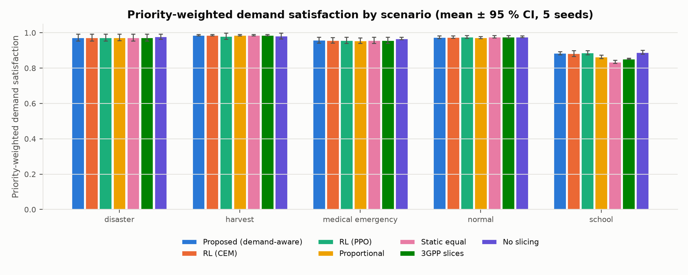
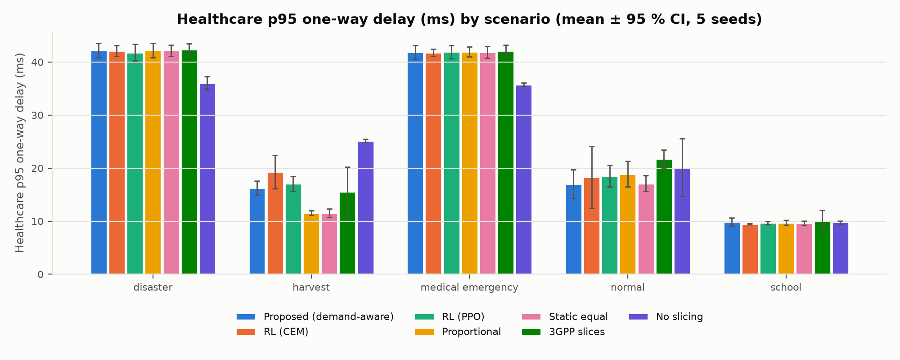
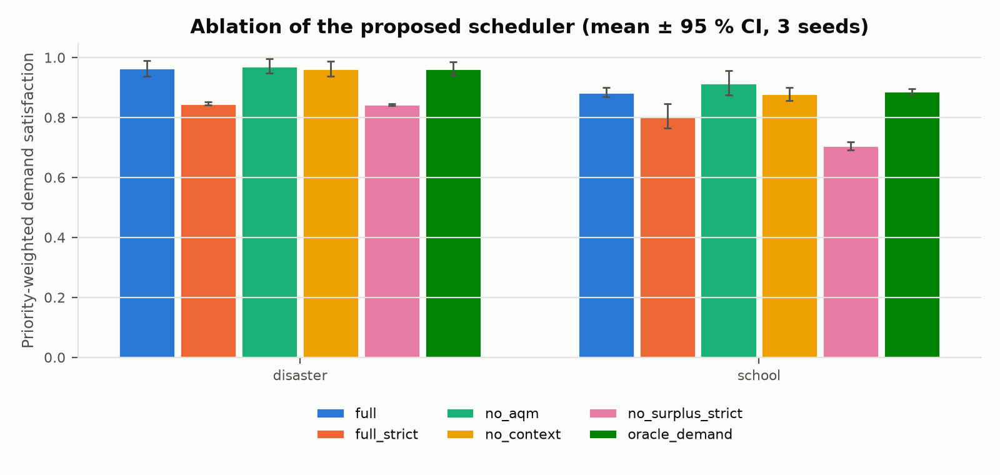
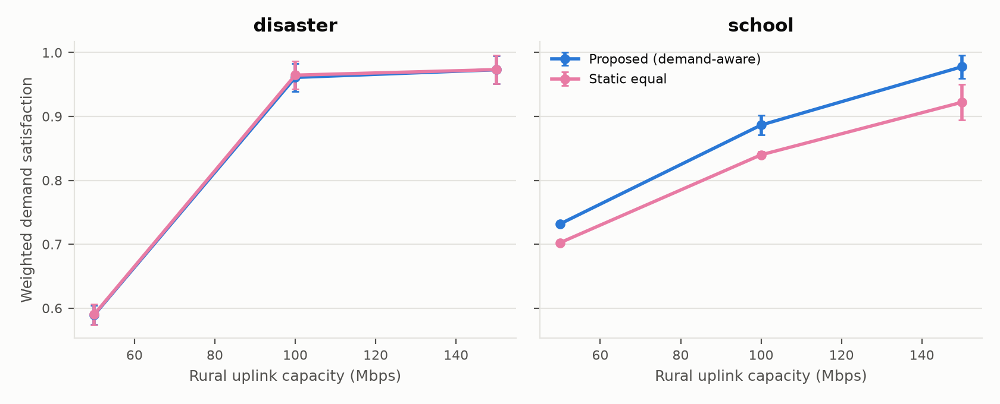
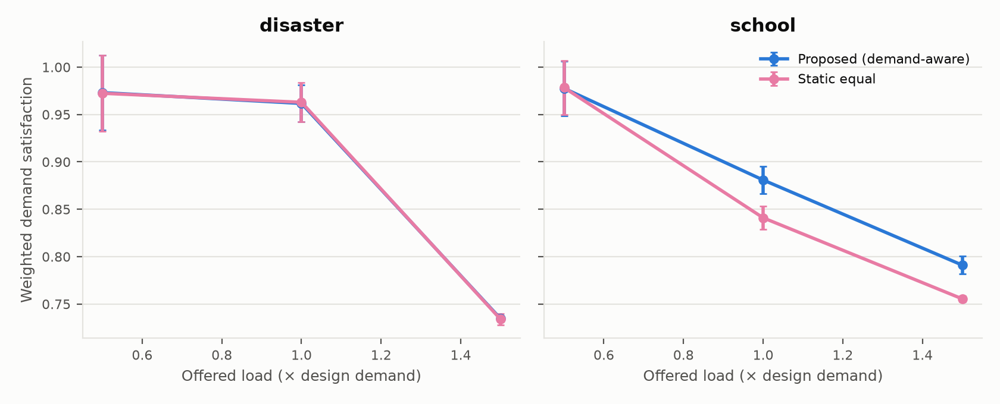
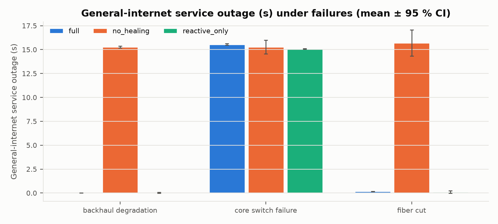
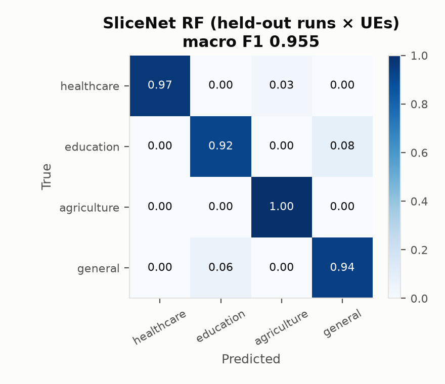
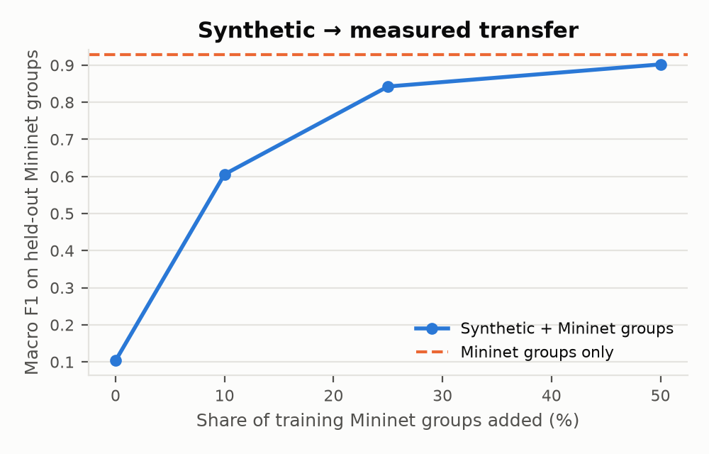
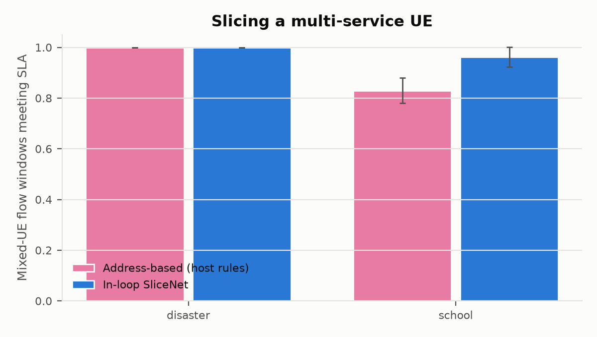
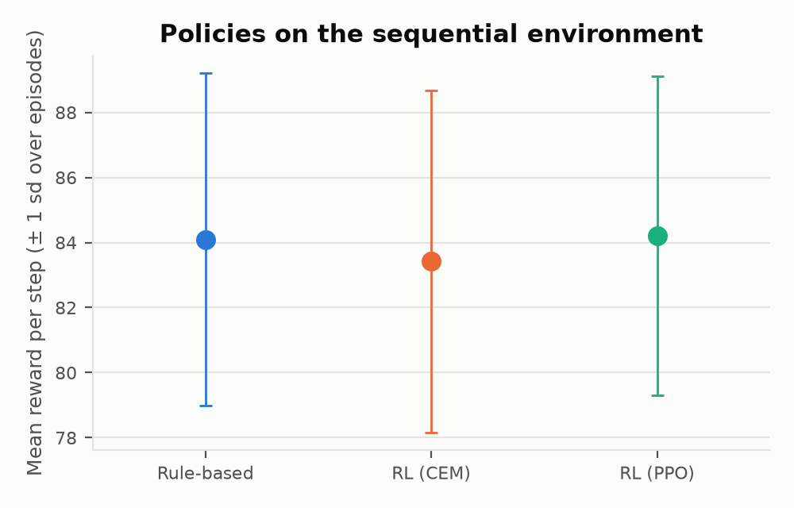

# Results

Generated by `experiments/report.py` from `results/tables/` (see [research_design.md](research_design.md) for the hypotheses and method). Every number is measured on the emulated network unless stated otherwise.

## Hypotheses

375 runs (main 200, ablation 36, sensitivity_capacity 36, sensitivity_load 36, resilience 27, slicenet_inloop 12, online_rl 10, scalability 9, timeline 9); 375 with packet-level measurements; median validation score 84/100.

| Hypothesis | Verdict | Evidence |
|---|---|---|
| H1a | **Not supported** | proposed vs tgpp / static_equal / no_slicing on weighted utility: False, False, False |
| H1b | **Not supported** | high-load healthcare p95 lower than tgpp/no_slicing: [True, False]; significant: [False, False] |
| H2 | **Supported** | disaster/no_aqm: no loss; disaster/no_context: worse; disaster/no_surplus_strict: worse; school/no_aqm: no loss; school/no_context: worse; school/no_surplus_strict: worse |
| H3 | **Not supported** | proposed − rl_ppo = +0.0004 (p = 0.7151); proposed − rl_cem = +0.0002 (p = 0.7970) |
| H4a | **Supported** | fiber cut, full healing: max outage per run [0.165, 0.15, 0.166] s |
| H4b | **Supported** | switched before cut in 100% of runs; mean outage predictive 0.013 s vs reactive 0.054 s |
| H5a | **Supported** | best held-out macro F1 = 0.9553 |
| H5b | **Not supported** | SliceNet > host-based in 1/2 scenarios |
| H6 | **Supported** | zero-shot F1 0.1035, with 50% measured groups 0.9021 |
| H7 | **Not supported** | proposed ≥ static_equal in 7/12 capacity/load settings |
| H8 | **Supported** | mean healthcare p95 by scenario: disaster: 349.0 vs 797.9 ms; school: 4.5 vs 5.4 ms |
| H9 | **Not supported** | proposed − context_unaware weighted utility +0.0022 (p = 0.0538, n = 25); healthcare SLA share Δ -0.0000 (p = 0.8648) |
| H10 | **Supported** | full − no_healing outage: education_outage_s -9.992 s (p = 0.0273); general_outage_s -10.171 s (p = 0.0391) |

## RQ1/RQ3 — Scheduler comparison (main study)

Mean across the five contexts (per-context values with 95 % CIs are in `results/tables/main_summary.csv`):

| scheduler | weighted utility | healthcare p95 (ms) | healthcare SLA share | Jain fairness |
|---|---|---|---|---|
| context_unaware | 0.954 | 26.108 | 0.889 | 0.987 |
| no_slicing | 0.960 | 25.369 | 0.786 | 0.994 |
| proportional | 0.951 | 24.865 | 0.893 | 0.991 |
| proposed | 0.956 | 25.429 | 0.889 | 0.985 |
| rl_cem | 0.956 | 26.174 | 0.888 | 0.983 |
| rl_ppo | 0.955 | 25.787 | 0.892 | 0.983 |
| static_equal | 0.946 | 24.450 | 0.889 | 0.992 |
| tgpp | 0.950 | 26.382 | 0.893 | 0.991 |

Paired Wilcoxon signed-rank tests, proposed vs each baseline, on (scenario, seed) pairs:

| baseline | metric | pairs | proposed_mean | baseline_mean | mean_difference | wilcoxon_p | significant_0.05 | significant_bonferroni |
|---|---|---|---|---|---|---|---|---|
| context_unaware | weighted_utility | 25 | 0.9558 | 0.9535 | 0.0022 | 0.05376 | False | False |
| context_unaware | healthcare_latency_p95_ms | 25 | 25.4288 | 26.1079 | -0.6791 | 0.35252 | False | False |
| context_unaware | healthcare_sla_satisfied_share | 25 | 0.8891 | 0.8891 | -0.0 | 0.864813 | False | False |
| no_slicing | weighted_utility | 25 | 0.9558 | 0.9595 | -0.0037 | 0.025835 | True | False |
| no_slicing | healthcare_latency_p95_ms | 25 | 25.4288 | 25.3692 | 0.0596 | 0.89486 | False | False |
| no_slicing | healthcare_sla_satisfied_share | 25 | 0.8891 | 0.7861 | 0.103 | 0.00065 | True | True |
| proportional | weighted_utility | 25 | 0.9558 | 0.9506 | 0.0052 | 0.019919 | True | False |
| proportional | healthcare_latency_p95_ms | 25 | 25.4288 | 24.8649 | 0.564 | 0.275184 | False | False |
| proportional | healthcare_sla_satisfied_share | 25 | 0.8891 | 0.8929 | -0.0038 | 0.400381 | False | False |
| rl_cem | weighted_utility | 25 | 0.9558 | 0.9556 | 0.0002 | 0.796987 | False | False |
| rl_cem | healthcare_latency_p95_ms | 25 | 25.4288 | 26.1737 | -0.7449 | 0.380984 | False | False |
| rl_cem | healthcare_sla_satisfied_share | 25 | 0.8891 | 0.8885 | 0.0006 | 0.528233 | False | False |
| rl_ppo | weighted_utility | 25 | 0.9558 | 0.9554 | 0.0004 | 0.715095 | False | False |
| rl_ppo | healthcare_latency_p95_ms | 25 | 25.4288 | 25.7871 | -0.3582 | 0.832509 | False | False |
| rl_ppo | healthcare_sla_satisfied_share | 25 | 0.8891 | 0.8916 | -0.0025 | 0.461451 | False | False |
| static_equal | weighted_utility | 25 | 0.9558 | 0.9461 | 0.0096 | 0.112365 | False | False |
| static_equal | healthcare_latency_p95_ms | 25 | 25.4288 | 24.4502 | 0.9787 | 0.070984 | False | False |
| static_equal | healthcare_sla_satisfied_share | 25 | 0.8891 | 0.8891 | 0.0 | 0.674424 | False | False |
| tgpp | weighted_utility | 25 | 0.9558 | 0.9497 | 0.0061 | 0.144243 | False | False |
| tgpp | healthcare_latency_p95_ms | 25 | 25.4288 | 26.3825 | -0.9536 | 0.126648 | False | False |
| tgpp | healthcare_sla_satisfied_share | 25 | 0.8891 | 0.8935 | -0.0044 | 0.224916 | False | False |

**Exploratory finding (not a pre-registered hypothesis).** Differences in healthcare SLA-met share that survive Bonferroni correction:

* proposed vs no_slicing: 0.889 vs 0.786 (Δ +0.103, p = 0.0006, n = 25 pairs)

## RQ2 — Ablation

| scenario | variant | n | weighted_utility_mean | weighted_utility_ci95 | healthcare_latency_p95_ms_mean | healthcare_latency_p95_ms_ci95 |
|---|---|---|---|---|---|---|
| disaster | full | 3 | 0.964 | 0.026 | 41.96 | 2.694 |
| disaster | full_strict | 3 | 0.846 | 0.005 | 47.006 | 2.018 |
| disaster | no_aqm | 3 | 0.972 | 0.025 | 35.984 | 2.088 |
| disaster | no_context | 3 | 0.962 | 0.024 | 41.992 | 3.375 |
| disaster | no_surplus_strict | 3 | 0.843 | 0.003 | 47.662 | 0.881 |
| disaster | oracle_demand | 3 | 0.963 | 0.022 | 42.3 | 3.035 |
| school | full | 3 | 0.884 | 0.016 | 9.479 | 0.299 |
| school | full_strict | 3 | 0.805 | 0.041 | 156.152 | 44.568 |
| school | no_aqm | 3 | 0.915 | 0.041 | 9.622 | 0.765 |
| school | no_context | 3 | 0.878 | 0.021 | 9.722 | 0.94 |
| school | no_surplus_strict | 3 | 0.705 | 0.014 | 180.926 | 85.967 |
| school | oracle_demand | 3 | 0.887 | 0.01 | 9.963 | 2.26 |

## RQ7 — Sensitivity Capacity

| scenario | scheduler | capacity_mbps | weighted_utility_mean | weighted_utility_ci95 |
|---|---|---|---|---|
| disaster | proposed | 50 | 0.59 | 0.015 |
| disaster | proposed | 100 | 0.961 | 0.022 |
| disaster | proposed | 150 | 0.973 | 0.022 |
| disaster | static_equal | 50 | 0.59 | 0.016 |
| disaster | static_equal | 100 | 0.965 | 0.022 |
| disaster | static_equal | 150 | 0.973 | 0.022 |
| school | proposed | 50 | 0.732 | 0.001 |
| school | proposed | 100 | 0.886 | 0.016 |
| school | proposed | 150 | 0.978 | 0.018 |
| school | static_equal | 50 | 0.702 | 0.002 |
| school | static_equal | 100 | 0.84 | 0.005 |
| school | static_equal | 150 | 0.922 | 0.028 |

## RQ7 — Sensitivity Load

| scenario | scheduler | load_scale | weighted_utility_mean | weighted_utility_ci95 |
|---|---|---|---|---|
| disaster | proposed | 0.5 | 0.973 | 0.04 |
| disaster | proposed | 1.0 | 0.962 | 0.02 |
| disaster | proposed | 1.5 | 0.734 | 0.003 |
| disaster | static_equal | 0.5 | 0.972 | 0.04 |
| disaster | static_equal | 1.0 | 0.963 | 0.021 |
| disaster | static_equal | 1.5 | 0.734 | 0.006 |
| school | proposed | 0.5 | 0.978 | 0.029 |
| school | proposed | 1.0 | 0.881 | 0.014 |
| school | proposed | 1.5 | 0.791 | 0.009 |
| school | static_equal | 0.5 | 0.978 | 0.028 |
| school | static_equal | 1.0 | 0.841 | 0.012 |
| school | static_equal | 1.5 | 0.756 | 0.003 |

## Scalability (UEs per service)

| ues_per_service | n | weighted_utility_mean | weighted_utility_ci95 | healthcare_latency_p95_ms_mean |
|---|---|---|---|---|
| 1.0 | 3.0 | 0.845 | 0.02 | 11.384 |
| 2.0 | 3.0 | 0.889 | 0.018 | 9.485 |
| 4.0 | 3.0 | 0.892 | 0.027 | 8.788 |

## RQ4 — Resilience

| scenario | variant | n | res_mttd_s_mean | res_mttr_control_s_mean | education_outage_s_mean | general_outage_s_mean | general_failover_lost_mean | weighted_utility_mean |
|---|---|---|---|---|---|---|---|---|
| backhaul_degradation | full | 3 | 15.668 | 15.695 | 0.013 | 0.008 | 2.333 | 0.95 |
| backhaul_degradation | no_healing | 3 | nan | nan | 15.146 | 15.266 | 614.333 | 0.848 |
| backhaul_degradation | reactive_only | 3 | 21.999 | 22.013 | 0.053 | 0.035 | 365.667 | 0.967 |
| core_switch_failure | full | 3 | 0.003 | 0.041 | 15.453 | 15.538 | 183.667 | 0.952 |
| core_switch_failure | no_healing | 3 | nan | nan | 15.332 | 15.264 | 185.333 | 0.954 |
| core_switch_failure | reactive_only | 3 | -0.013 | 0.081 | 15.085 | 15.085 | 176.667 | 0.95 |
| fiber_cut | full | 3 | 0.008 | 0.045 | 0.071 | 0.16 | 122.0 | 0.972 |
| fiber_cut | no_healing | 3 | nan | nan | 15.035 | 15.691 | 186.667 | 0.942 |
| fiber_cut | reactive_only | 3 | 0.0 | 0.037 | 0.066 | 0.104 | 87.0 | 0.971 |

Post-recovery verification (full healing): 14 recoveries verified, 0 unverified, 3 escalations across 9 runs; median time to verified restore 1.983 s.

Paired tests, full healing vs each variant on (scenario, seed) pairs (negative difference = full healing lower):

| baseline | metric | pairs | full_mean | baseline_mean | mean_difference | wilcoxon_p |
|---|---|---|---|---|---|---|
| no_healing | education_outage_s | 9 | 5.1789 | 15.1712 | -9.9923 | 0.027344 |
| no_healing | general_outage_s | 9 | 5.2353 | 15.4068 | -10.1714 | 0.039062 |
| no_healing | education_failover_lost | 9 | 264.5556 | 4924.3333 | -4659.7778 | 0.054688 |
| no_healing | general_failover_lost | 9 | 102.6667 | 328.7778 | -226.1111 | 0.015625 |
| no_healing | weighted_utility | 9 | 0.9579 | 0.9144 | 0.0436 | 0.039062 |
| reactive_only | education_outage_s | 9 | 5.1789 | 5.068 | 0.1109 | 0.570312 |
| reactive_only | general_outage_s | 9 | 5.2353 | 5.0749 | 0.1604 | 0.164062 |
| reactive_only | education_failover_lost | 9 | 264.5556 | 93.3333 | 171.2222 | 0.589844 |
| reactive_only | general_failover_lost | 9 | 102.6667 | 209.7778 | -107.1111 | 0.714844 |
| reactive_only | res_mttr_control_s | 9 | 5.2604 | 7.3767 | -2.1162 | 0.039062 |
| reactive_only | weighted_utility | 9 | 0.9579 | 0.9627 | -0.0048 | 0.425781 |
| reactive_only | time_to_restore_s | 9 | 1.3212 | 0.8906 | 0.4307 | 0.886719 |

## RQ5/RQ6 — SliceNet

Measured dataset: 4655 flow windows from 18 runs; evaluation holds out whole run × UE groups.

| model | macro F1 | accuracy | test windows | healthcare | education | agriculture | general |
|---|---|---|---|---|---|---|---|
| random_forest | 0.9553 | 0.9488 | 1191 | 0.984 | 0.917 | 0.985 | 0.936 |
| cnn_1d | 0.8504 | 0.8514 | 1191 | 0.86 | 0.801 | 0.87 | 0.871 |

| mininet_fraction | mininet_groups | f1_macro |
|---|---|---|
| 0.0 | 0.0 | 0.1035 |
| 0.1 | 7.0 | 0.6058 |
| 0.25 | 18.0 | 0.8425 |
| 0.5 | 36.0 | 0.9021 |

Measured-only (same shared columns): macro F1 0.9287.

### In-loop slicing of a mixed-service UE

| scenario | classification | n | mixed_sla_share_mean | mixed_sla_share_ci95 | online_accuracy_mean | mixed_healthcare_sla_share_mean |
|---|---|---|---|---|---|---|
| disaster | host | 3 | 1.0 | 0.0 | nan | 1.0 |
| disaster | slicenet | 3 | 1.0 | 0.0 | 1.0 | 1.0 |
| school | host | 3 | 0.83 | 0.05 | nan | 1.0 |
| school | slicenet | 3 | 0.961 | 0.039 | 0.833 | 1.0 |

## Learning engine on the sequential environment (simulation)

Held-out evaluation seeds (disjoint from training and validation seeds), 30 episodes × 120 steps, shared reward:

| policy | mean_reward | std_reward | sla_violations_per_episode | mean_satisfaction |
|---|---|---|---|---|
| rule_based | 10001.93 | 605.7 | 36.37 | 0.8862 |
| rl_cem | 10051.44 | 590.97 | 37.67 | 0.8968 |
| rl_ppo | 10032.81 | 599.2 | 39.07 | 0.8968 |

Paired over the same episodes (policy − rule-based):

| policy | episodes | mean_diff | ci95 | relative_pct | wilcoxon_p | wins | losses |
|---|---|---|---|---|---|---|---|
| rl_cem | 30 | 49.513 | [37.272, 61.753] | 0.495 | 0.0 | 29 | 1 |
| rl_ppo | 30 | 30.878 | [1.195, 60.562] | 0.309 | 0.000283 | 27 | 3 |

PPO seeds [0, 1, 2]: test reward 10030.37 ± 1.77 (per seed {'0': 10029.66, '1': 10028.64, '2': 10032.81}); deployed seed 2 (best validation score).

## Mininet online learning (online CEM, consecutive live runs)

Exploratory: the policy starts from the simulator-trained CEM policy and updates only from live transitions whose allocation was verified in the kernel. Runs are sequential, so the trend mixes learning with seed effects.

| scenario | seed | rl_transitions | rl_transition_mean_reward | weighted_utility | enforcement_failed |
|---|---|---|---|---|---|
| disaster | 0 | 16 | 94.589 | 0.99 | 0 |
| disaster | 1 | 17 | 93.331 | 0.972 | 0 |
| disaster | 2 | 17 | 92.993 | 0.972 | 0 |
| disaster | 3 | 14 | 94.557 | 0.992 | 0 |
| disaster | 4 | 16 | 94.221 | 0.988 | 0 |
| school | 0 | 18 | 86.79 | 0.888 | 0 |
| school | 1 | 16 | 85.201 | 0.876 | 0 |
| school | 2 | 19 | 87.149 | 0.889 | 0 |
| school | 3 | 20 | 86.151 | 0.873 | 0 |
| school | 4 | 21 | 86.806 | 0.875 | 0 |

## RQ8 — Real 5G core (Open5GS + UERANSIM, 10 Mbps UPF bottleneck)

| scenario | mode | seed | healthcare p95 | healthcare SLA | agriculture p95 | weighted utility |
|---|---|---|---|---|---|---|
| disaster | cars_sf | 0 | 275.352 | 0.5278 | 27.352 | 0.8232 |
| disaster | cars_sf | 1 | 302.186 | 0.5556 | 13.969 | 0.8432 |
| disaster | cars_sf | 2 | 469.354 | 0.5 | 27.13 | 0.8785 |
| disaster | no_slicing | 0 | 760.089 | 0.0833 | 756.687 | 0.852 |
| disaster | no_slicing | 1 | 812.214 | 0.0278 | 808.358 | 0.8721 |
| disaster | no_slicing | 2 | 821.352 | 0.0 | 821.601 | 0.879 |
| school | cars_sf | 0 | 4.742 | 1.0 | 8.114 | 0.7341 |
| school | cars_sf | 1 | 4.161 | 1.0 | 5.887 | 0.7197 |
| school | cars_sf | 2 | 4.469 | 1.0 | 9.885 | 0.7404 |
| school | no_slicing | 0 | 4.737 | 1.0 | 7.969 | 0.6563 |
| school | no_slicing | 1 | 5.981 | 1.0 | 6.006 | 0.6553 |
| school | no_slicing | 2 | 5.604 | 1.0 | 8.535 | 0.7102 |

